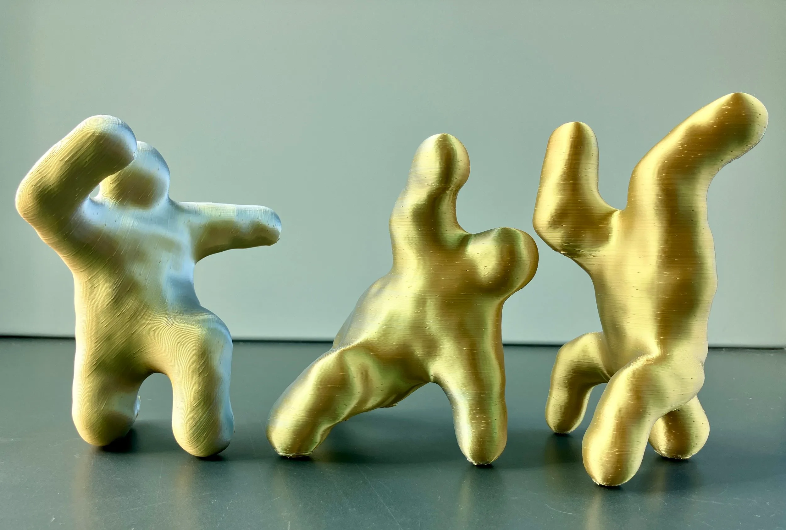
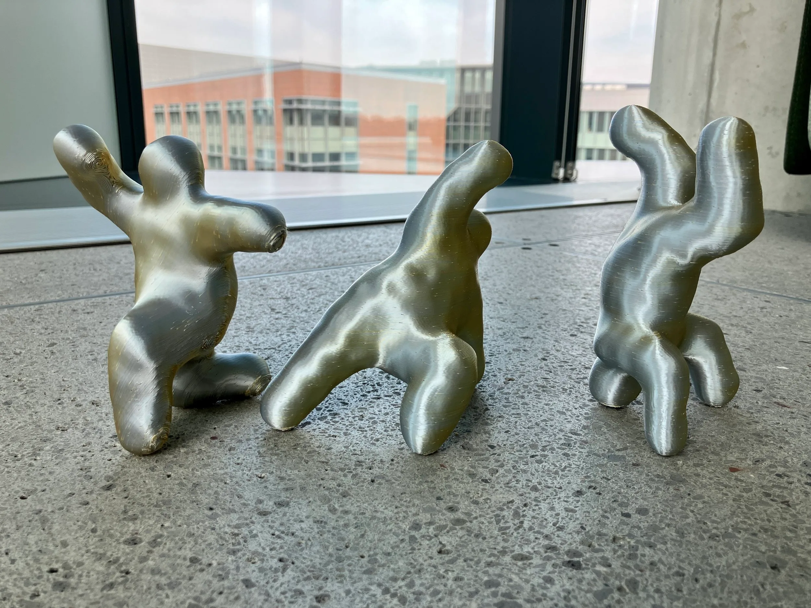
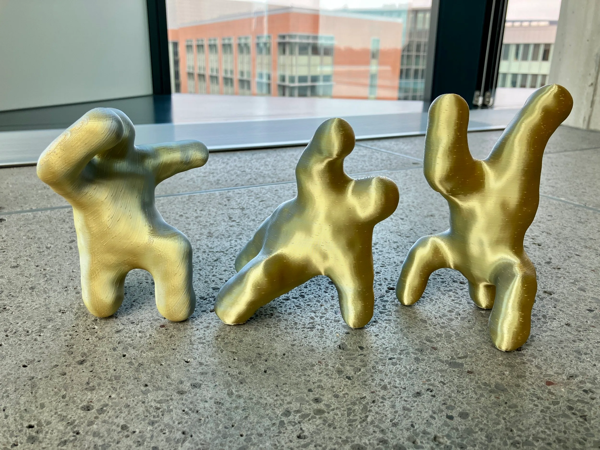
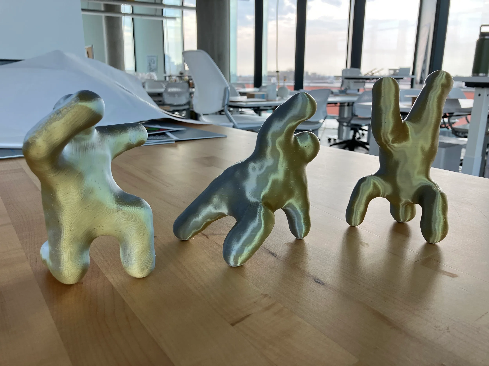

A series of figures I modeled and 3D printed. The poses are loosely based somewhere between dancing Ewoks and the Planet of the Apes Musical choreography from the Simpsons. I wanted to create figures that were abstract and fun yet still human. Modeled in Cinema 4D and printed in PLA on the Bambu X1C.

::: grid-2

:::
