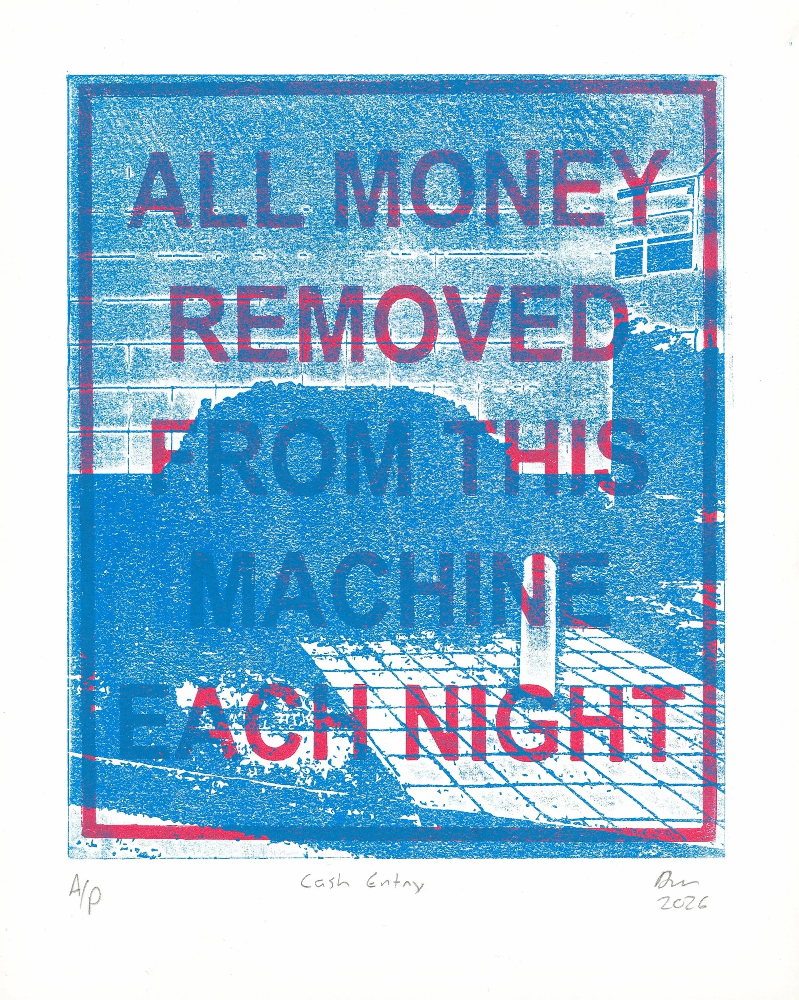
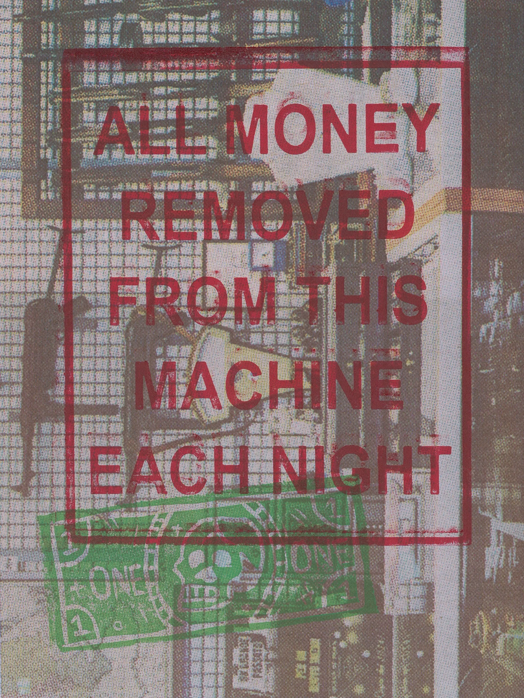
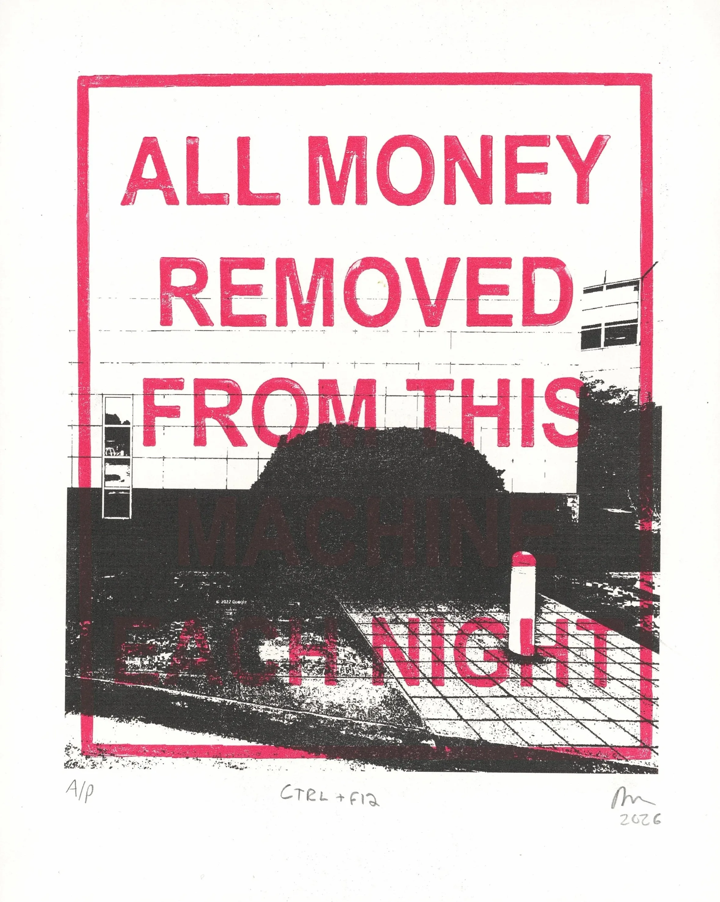
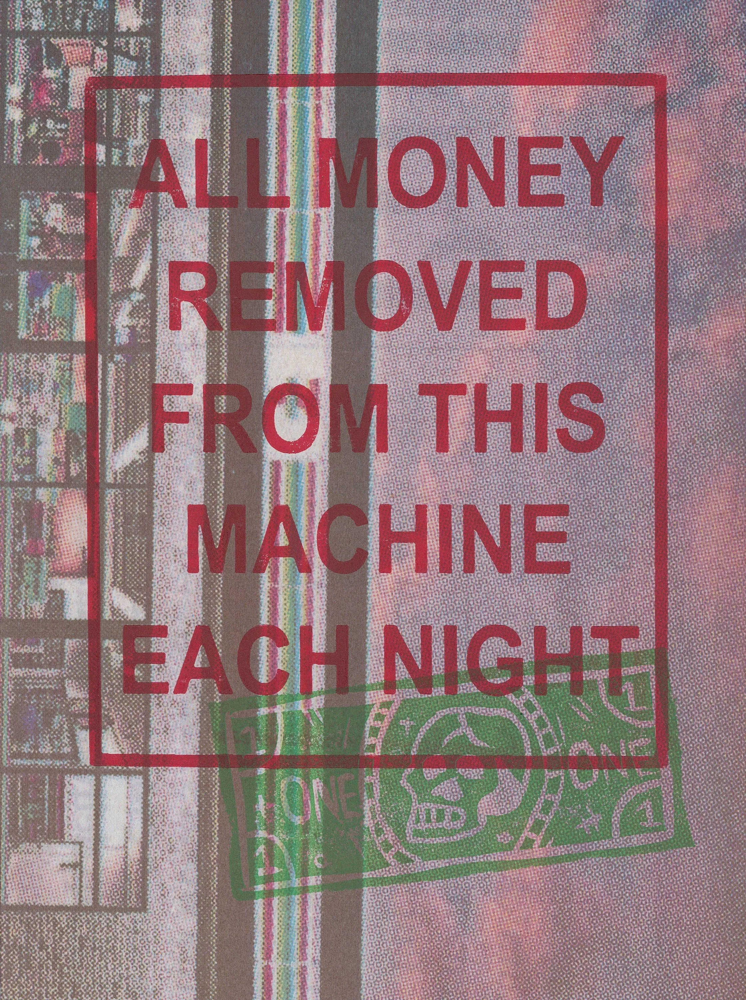
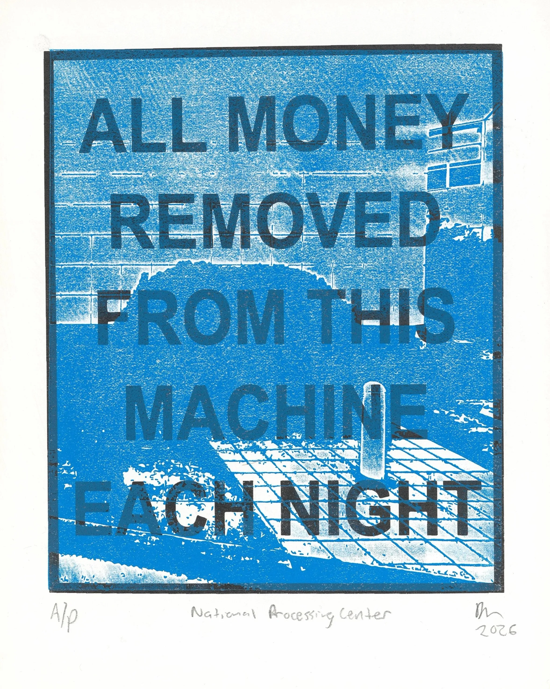
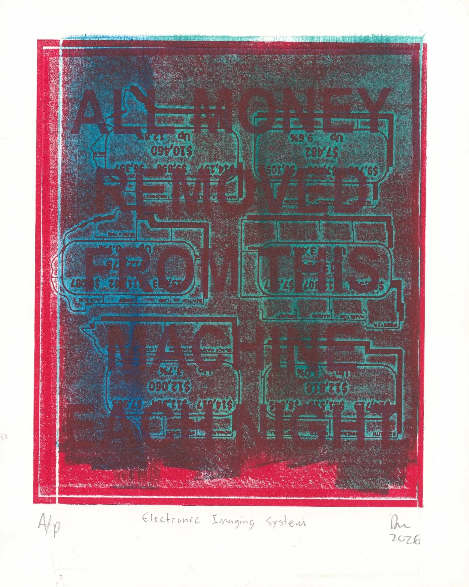
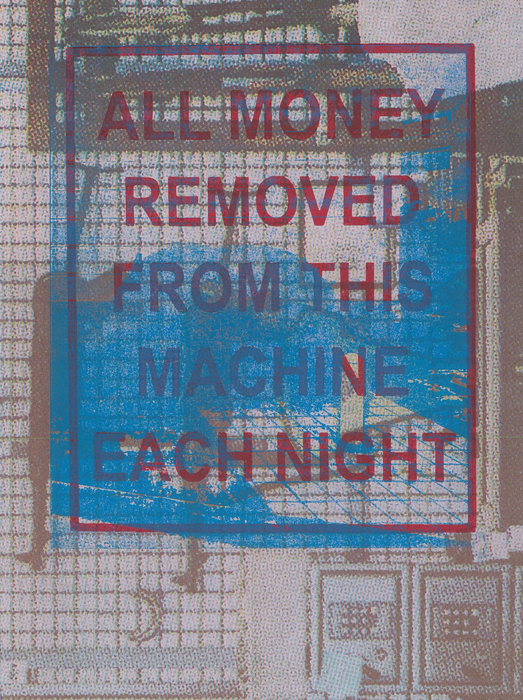
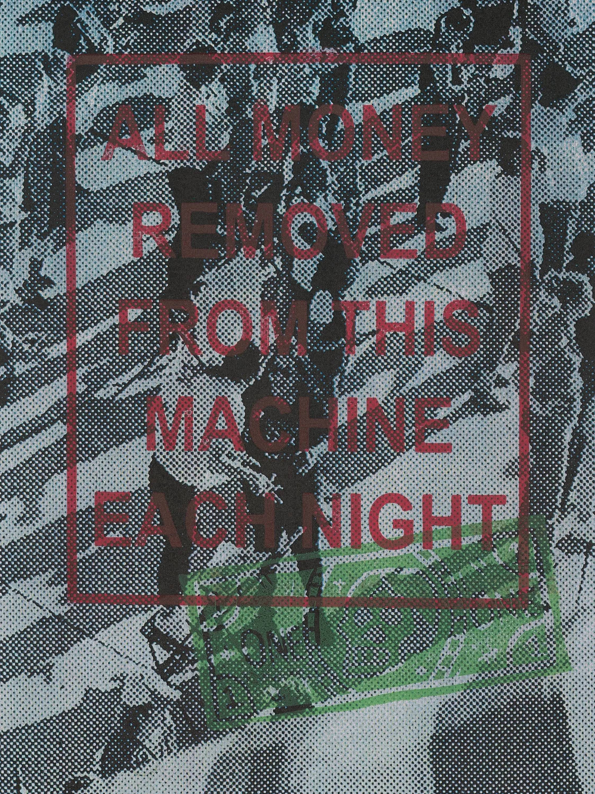
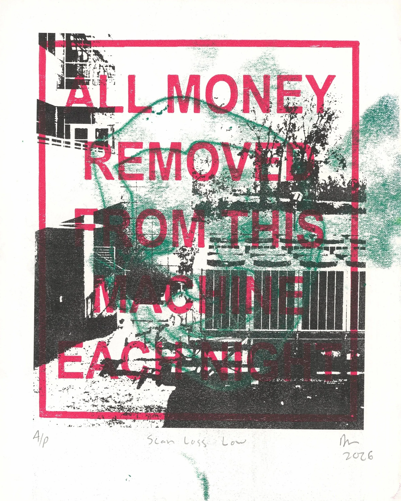

This series of relief prints focuses on the principle of maximum value extraction: from the land, our bodies and our ways of thinking. All resources and ways of being are eventually subsumed into the quantification of value – i.e. “all money removed from this machine each night.” Each image in the series contextualizes this overarching principle within specific instances of its application: land valuation maps, sterile rectangular insurance buildings, crowds at a protest, convenience stores and Iowa agribusiness.

::: grid-3

:::

## Process and Materials

My process for the series involved creating a number of repeatable images and matrices using digital methods: laser printed images, 3D-printed relief plates and laser-etched acrylic plates. I also carved a tofu block stamp that could be repeated and layered by hand. I contrasted these reproducible images with more expressive painterly and trace monotypes. By combining these methods, I sought to investigate the application of overwhelming mechanical systems to unique, humanist images.

The digital images are sourced from my life, both past and present. A warning label from a Pepsi machine served as the seed phrase for the project. Google Street View provided images of the office building from my crop insurance temp job 20 years ago. The experience of growing up and living in agribusiness-dominated Iowa provided connections to land (de)valuation. Scanned halftone newspaper images from previous work, including protest photos, convenience stores and gun sales also added context to the series.

I printed around 36 images for this series. While many of the earliest printed layers explored abstract painterly monotypes and figurative trace drawings, the images become increasingly mechanical as the series and layers advanced. The most ‘successful’ images in the series were those created with mostly repeatable matrices - 3D printed and acrylic plates. Is this because they are more engaging, or am I inherently biased towards mechanically/digitally reproducible images? Did the production and schedule constraints drive this kind of work? Am I disgusted by the overarching drive towards quantification and value, or am I most at home in that system?

## Image List

- *Gun Sales* (2026) 8.5 x 11" found print document, 3D Printed Plate, tofu block stamp
- *Cash Entry* (2026) 8 x 10" 3D Printed Plate, laser etched acrylic plate
- *Always Open* (2026) 8.5 x 11" found print document, 3D Printed Plate, tofu block stamp
- *CTRL + F12* (2026) 8 x 10" digital print, 3D Printed Plate
- *National Processing Center* (2026) 8 x 10" 3D Printed Plate, acrylic laser etched plate
- *Community* (2026) 8.5 x 11" found print document, 3D Printed Plate, tofu block stamp
- *Industrial Complex* (2026) 8.5 x 11" found laser print document, 3D Printed Plate, laser etched acrylic plate
- *Electronic Imaging System* (2026) 8 x 10" painterly monotype, 3D Printed Plate, laser etched acrylic plate
- *Scan Loss Low* (2026) 8 x 10" digital print, 3D Printed Plate, trace monotype
