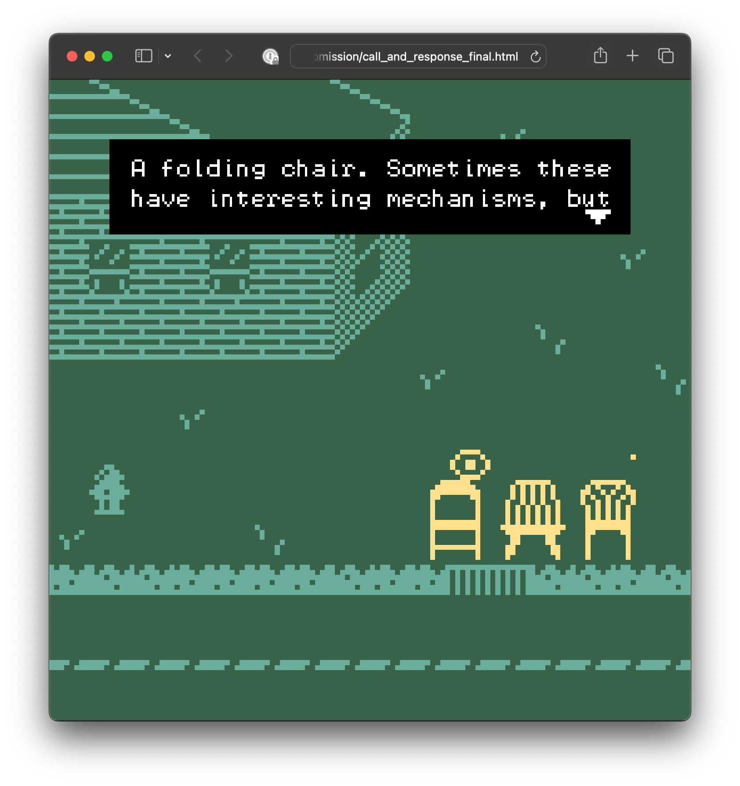
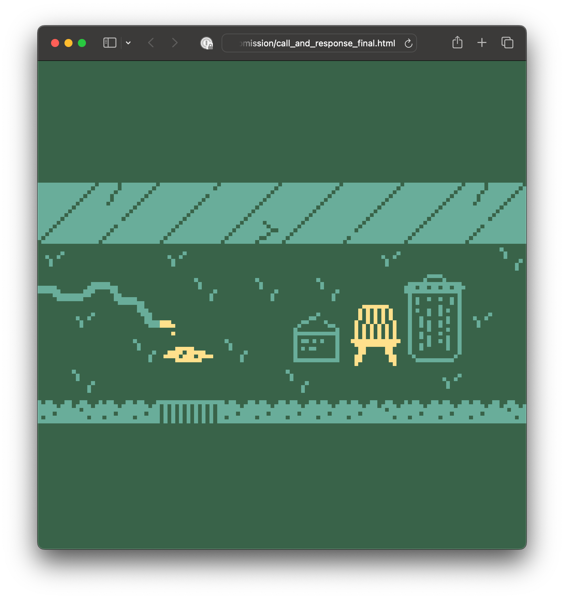
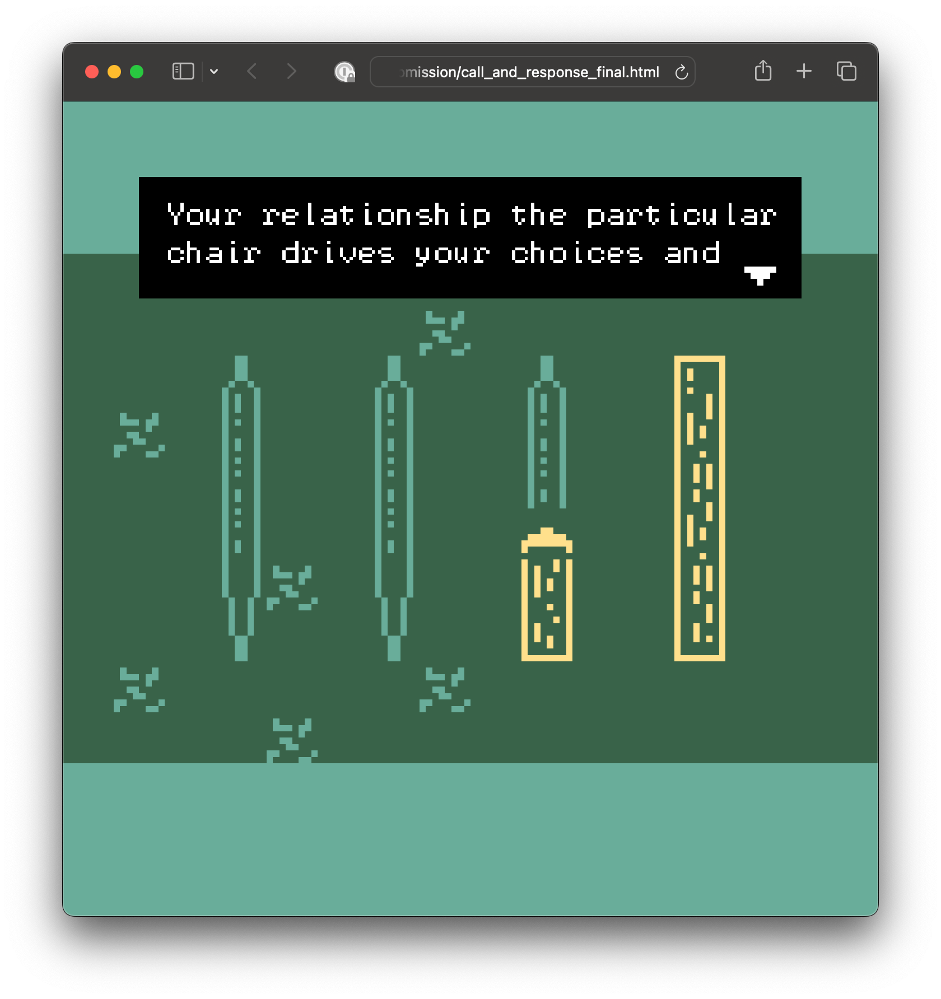
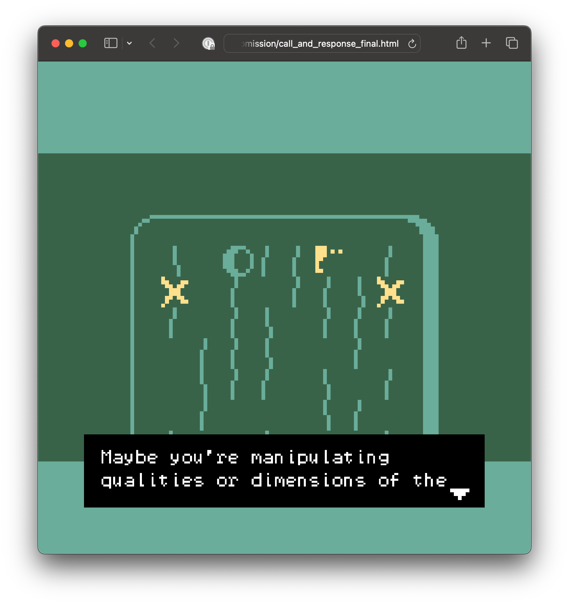
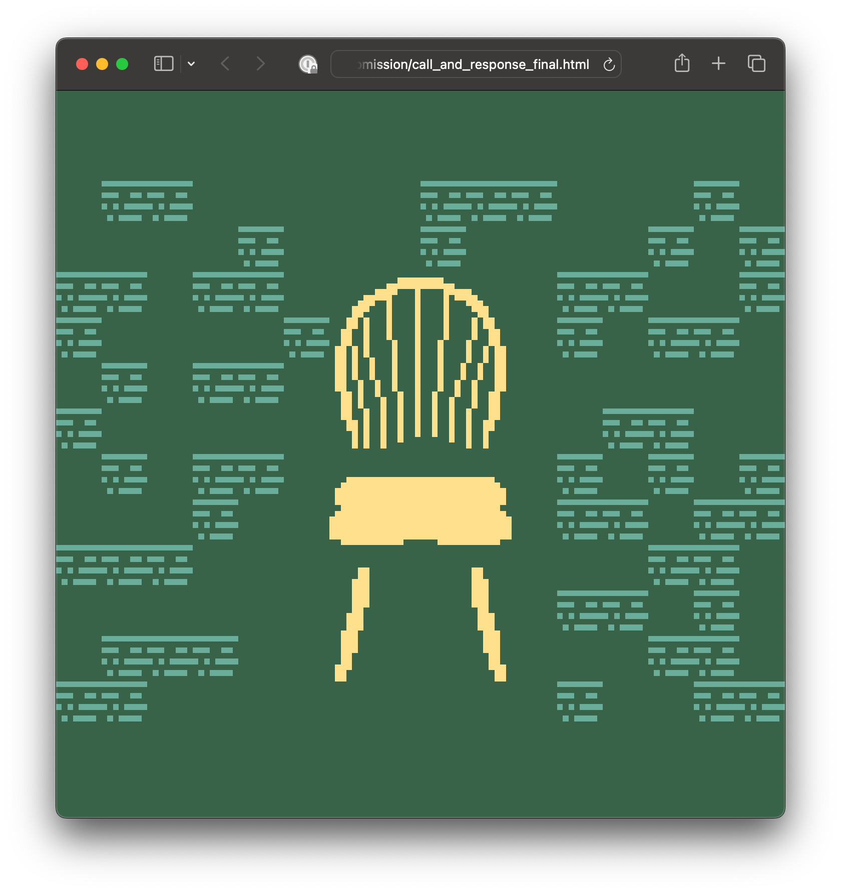
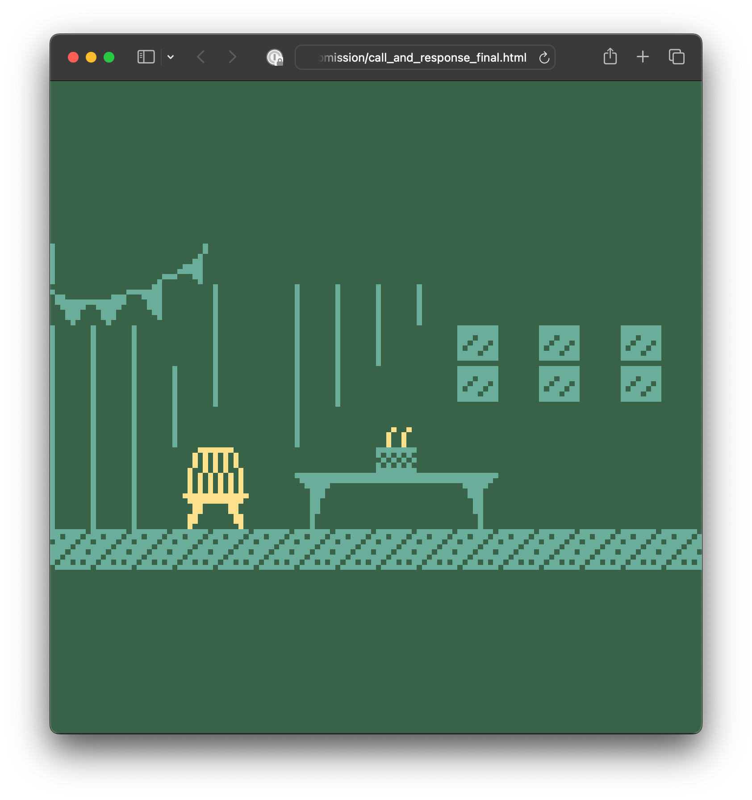

My goal for this piece was to create a meditative, inviting way for the Ames, Iowa community to 1) learn more about Peter Scheidt’s sculpture practice and 2) reflect on their own relationship with furniture and lived reality. Many of the themes in the game came directly from an interview I conducted with Peter, and the rest were from having spend a semester in his Furniture Design studio. My personal goal for the project was to explore interactive digital experiences as an applied storytelling medium.

—

*[Peter Scheidt’s](https://peterscheidt.com/) creative studio work is research and concept-driven, yet firmly grounded in the craft of furniture and woodworking. His sculptures explore questions of function, non-function, and meaning by manipulating and altering found and discarded furniture. Peter is an Assistant Professor in Art and Visual Culture at Iowa State University.*

[Play Call and Response on itch.io](https://technolumina.itch.io/call-and-response)

::: grid-3

:::
