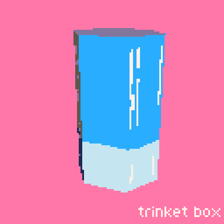
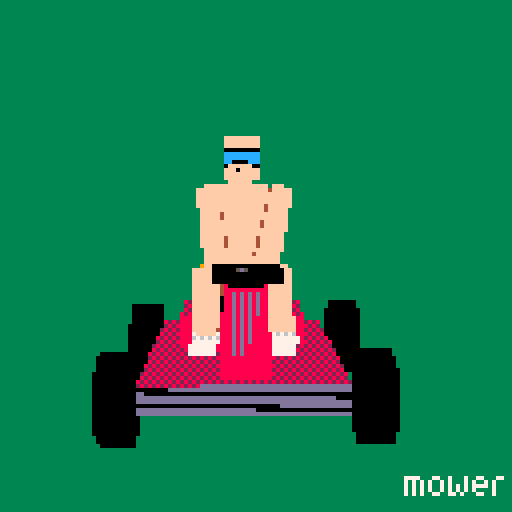
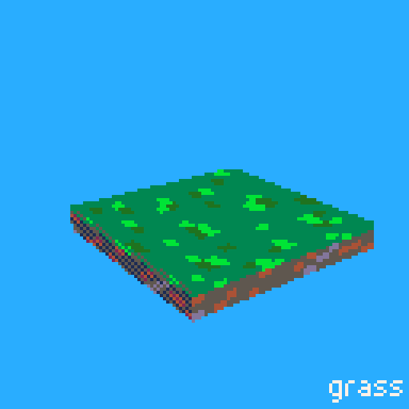
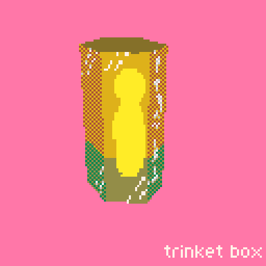
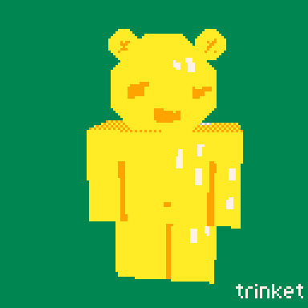
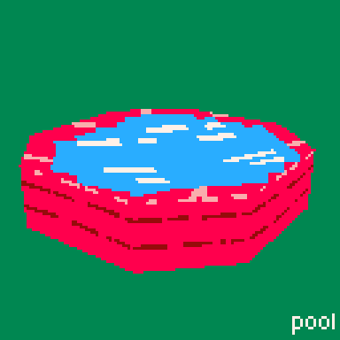
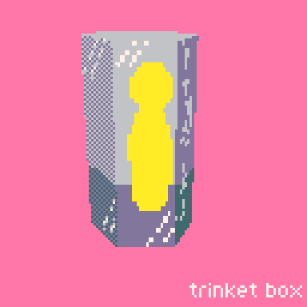
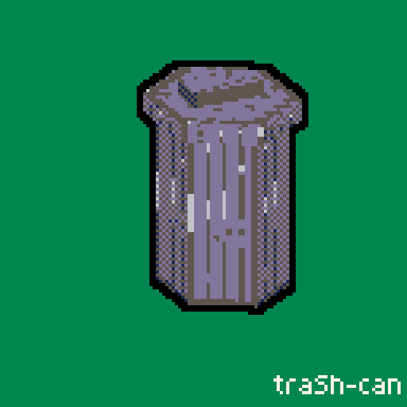
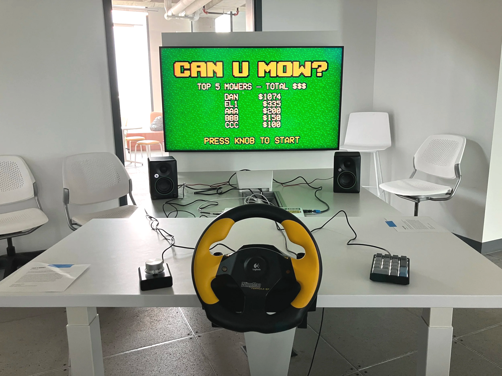

**CAN U MOW?** explores continuous consumption, dopamine addiction and the capitalist need to constantly earn one’s keep. The game throws participants into a stressful, hyper-commercial mowing simulation that lasts until your dopamine runs out or your customer rating drops to zero. Interacting with the simulation is intentionally frustrating, with three separate controllers and multiple on-screen events fighting for attention. A competitive leaderboard lures players back to the simulation and undermines any thoughts of rejecting it outright.

—

*Game engine: Godot  
Assets: picoCAD2  
Sound: [https://heltonyan.itch.io/pixelcombat](https://heltonyan.itch.io/pixelcombat)*

## installation & Gameplay

::: video https://youtu.be/ADrhukCFFsg "CAN U MOW? – Installation and Gameplay"
:::

## Game assets

3D models created in picoCAD2 and rendered as 2D sprite sheets.

::: grid-3

:::

## controller setup

Game controller steering wheel and pedals, 10-key number pad and USB volume knob/clicker.

