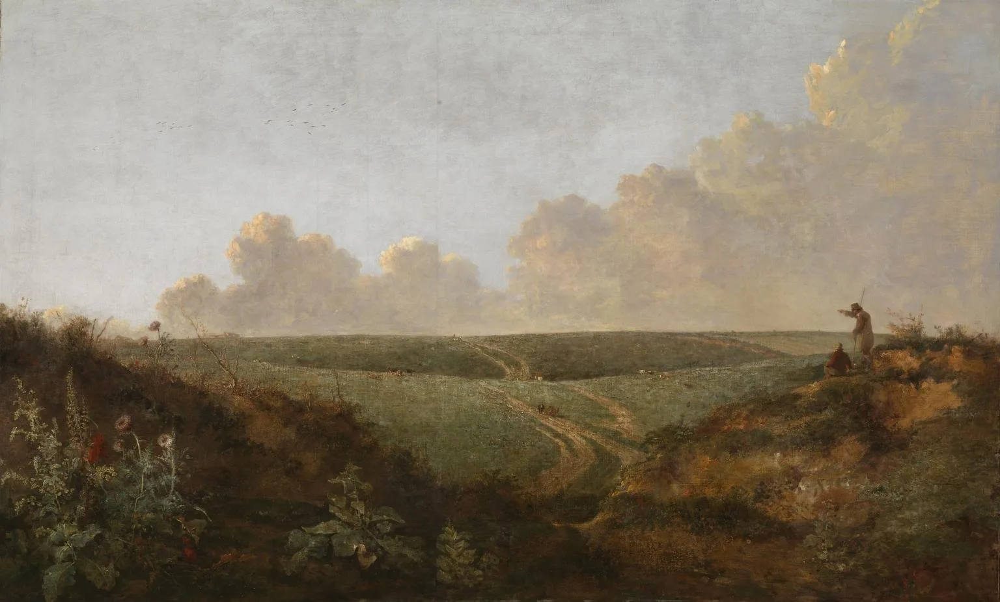
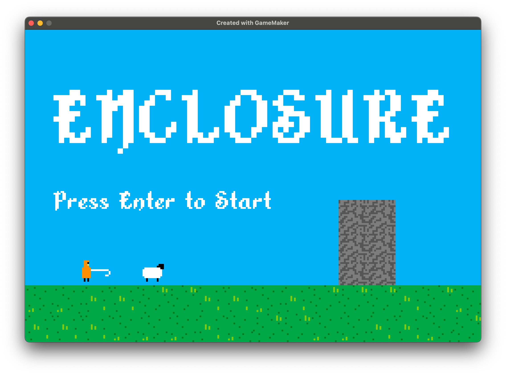
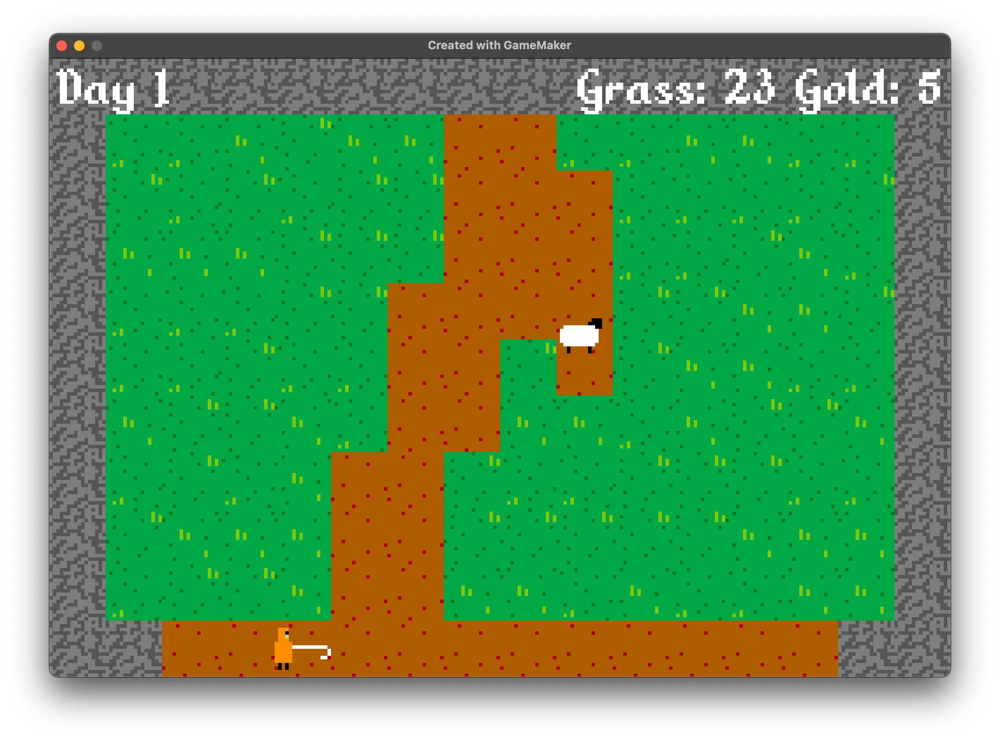
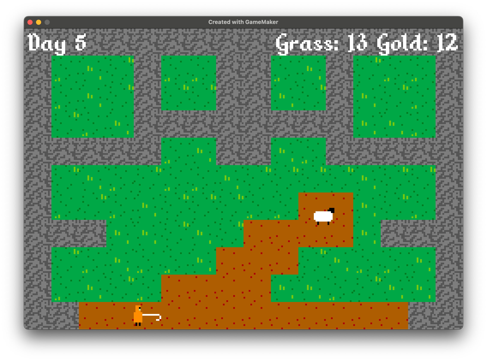
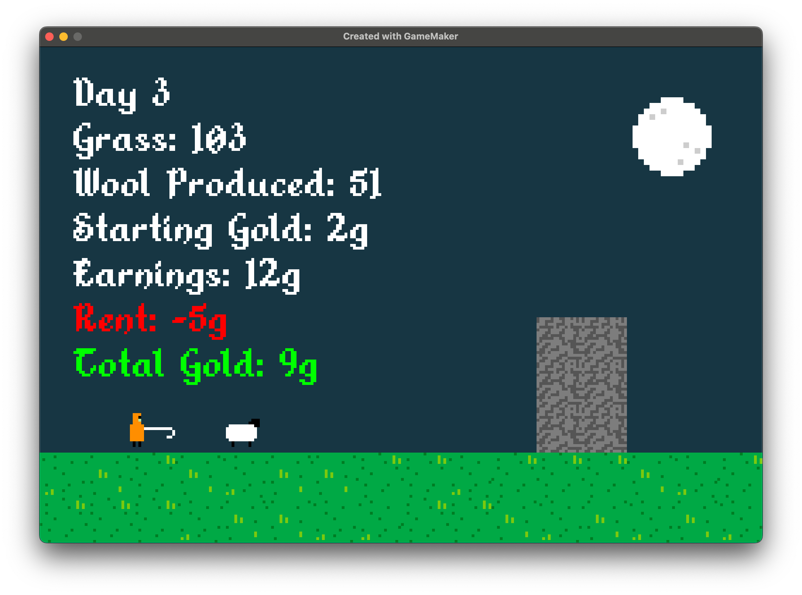
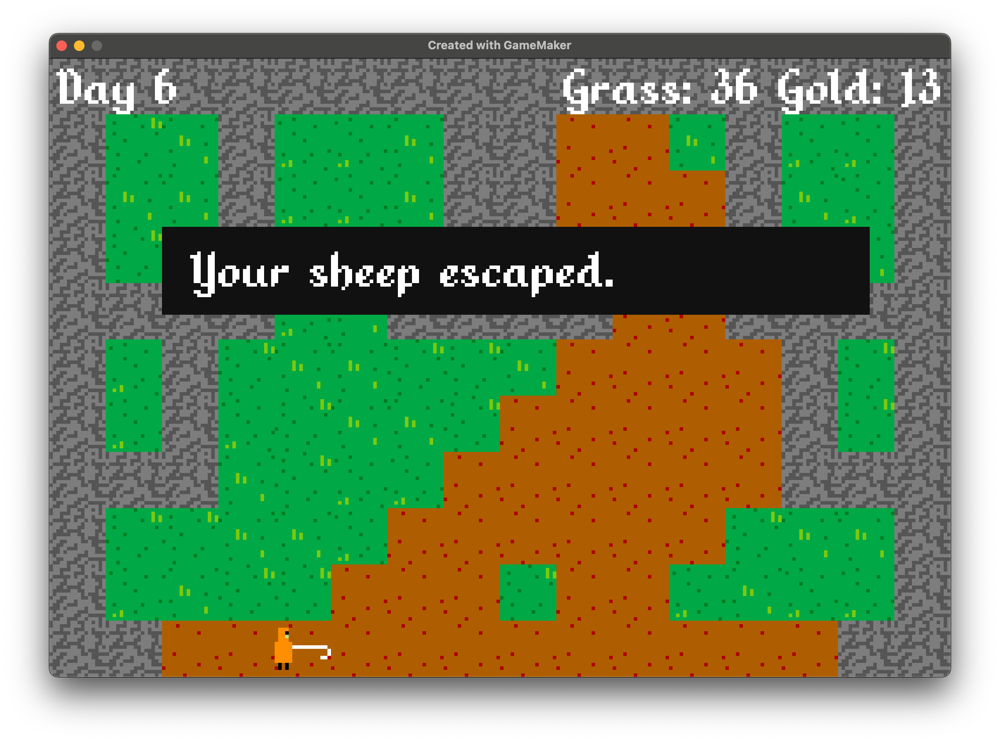
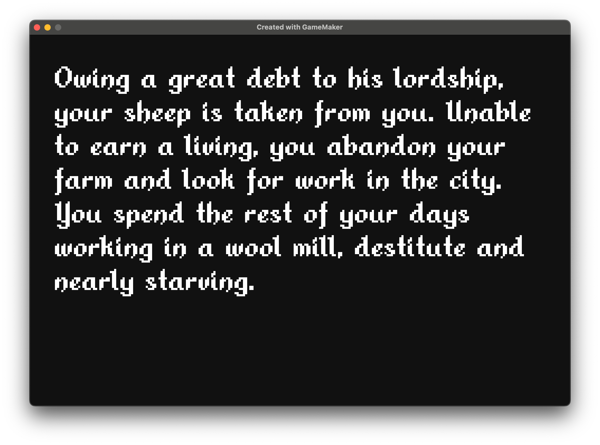
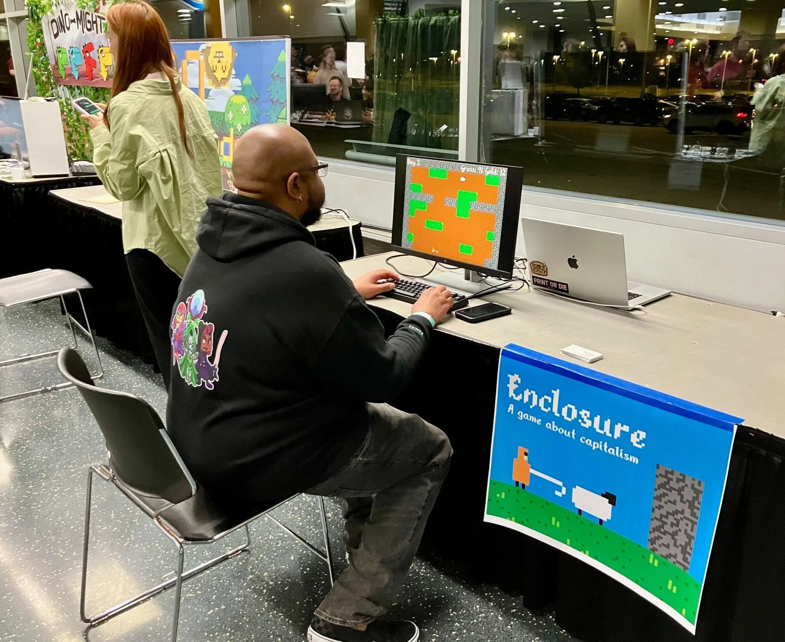
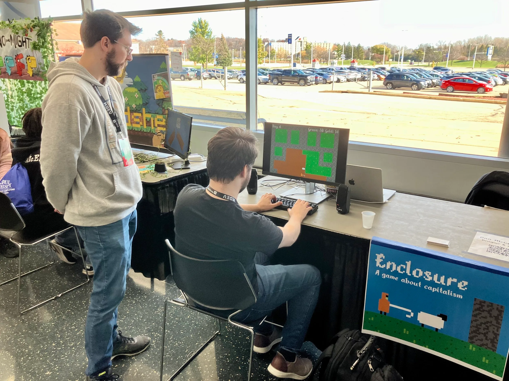

::: full

:::

## A medieval brick-breaker about the perils of capitalism

[Play Enclosure on itch.io](https://technolumina.itch.io/enclosure)

## About the Game

The commons will soon be fenced off as private property. Can you, a simple shepherd, keep producing enough wool to make rent?

*Enclosure* takes place in medieval England during the onset of market capitalism. You play as a shepherd trying to earn a living while your access to public grazing land continually diminishes. The game provides a fun and accessible way to learn about the origins of capitalism and experience disenfranchisement in the face of privatization.

I designed and developed *Enclosure* over the course of a week using [GameMaker.](https://gamemaker.io/)

::: grid-3

:::

## Enclosure @ M+DEV 2024

*Enclosure* was featured in the Indie Showcase at M+DEV 2024 in Madison, WI.

::: grid-2

:::

[Play Enclosure on itch.io](https://technolumina.itch.io/enclosure)
