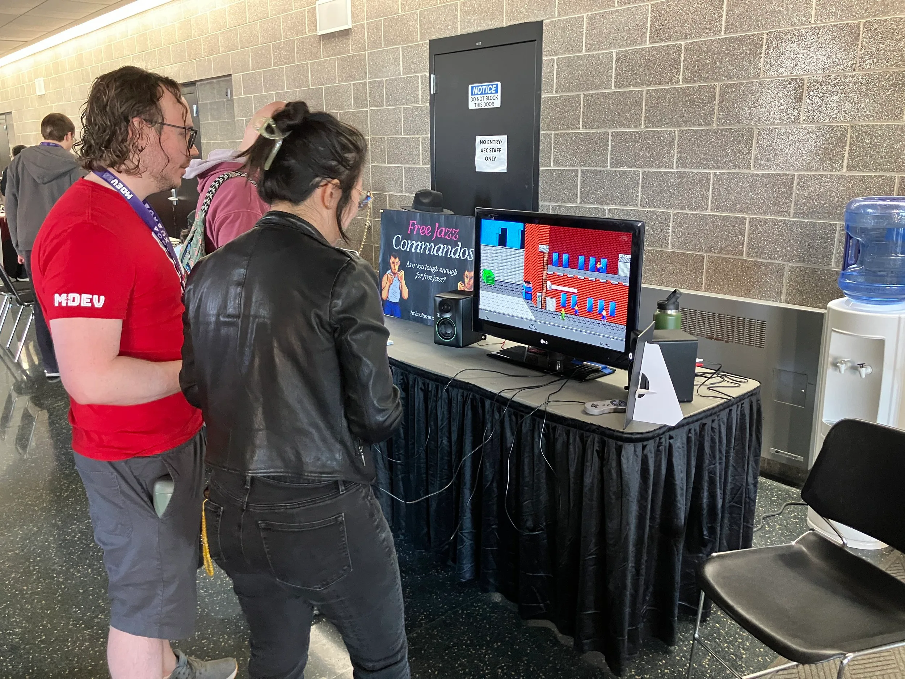
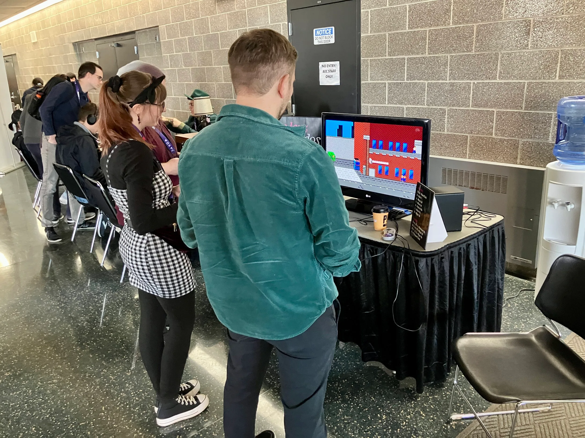
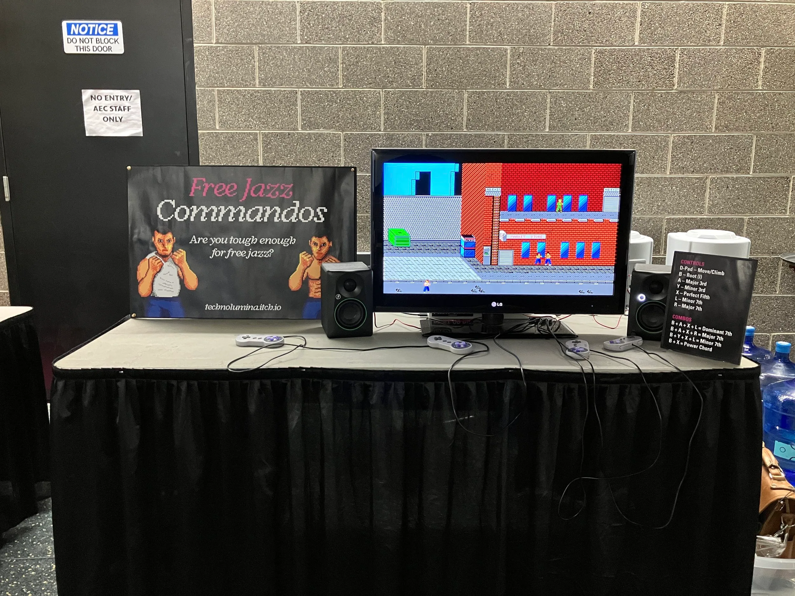

An interactive musical commando raid for 1 to 4 players. Instead of defeating an enemy (or each other) or working towards a goal, the players are left to their own devices in a city block that doubles as a musical instrument. Do you work together and play something cohesive? Do you just mash buttons? Are you tough enough for free jazz? Designed and developed by me using p5Play.js, q5.js, tone.js and tonal.js.

Sprites and background assets by [chasersgaming](https://chasersgaming.itch.io/).

*Featured at M+DEV 2025 Indie Showcase – Madison, WI.*

[Play Free Jazz Commandos on itch.io](https://technolumina.itch.io/free-jazz-commandos)

::: video https://youtu.be/yqSLJKlderY "Free Jazz Commandos – Gameplay Demo"
:::

## Free jazz commandos @ M+DEV 2025

::: grid-3

:::

<!-- TODO(video): upload imported-content/assets/free-jazz-commandos-video-1.mp4 to YouTube, then replace this comment with a YouTube block: a line ::: video https://youtu.be/VIDEO_ID "Title" followed by a closing ::: line (the title is required) -->
