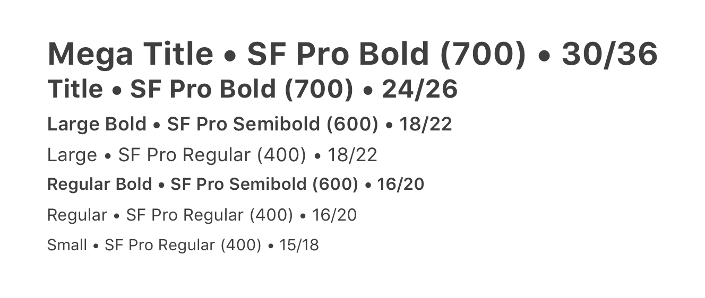
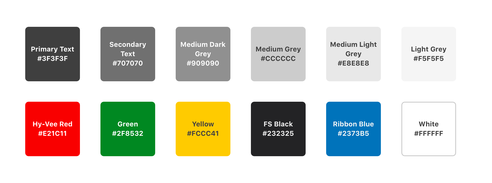
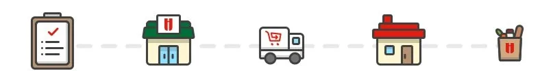
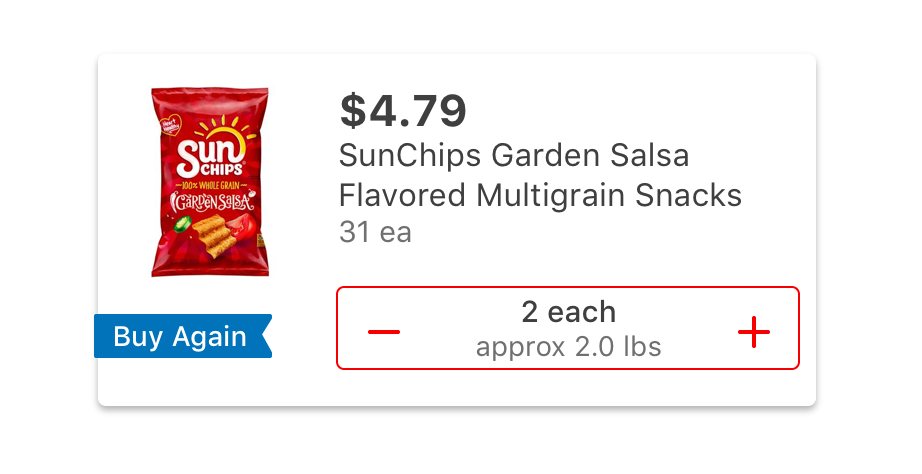
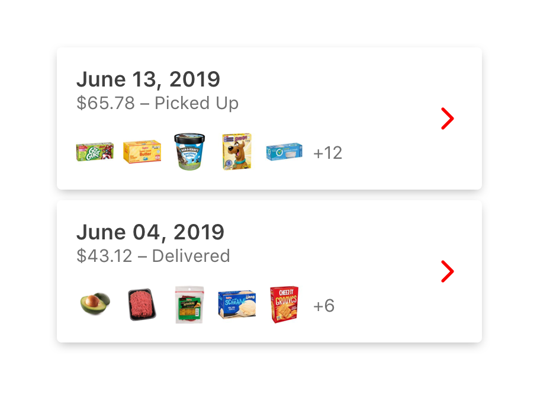
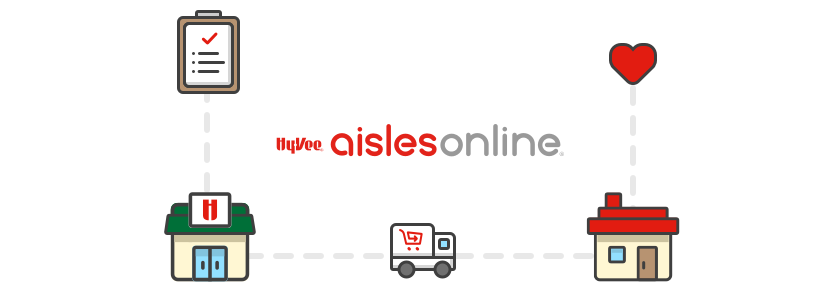

As the Aisles Online mobile app scaled up and new engineers joined the project, implementing consistent visual designs across the platform became difficult. The increasing velocity also made testing and delivering designs on deadline a challenge. I created the Grocery Design System to help address both issues.

## Role

I started as the only UI/UX designer on the project, collaborating with a team of five engineers, the tech lead and the product owner to implement the design system across the app. As more teams and designers started contributing to the app, I worked with them to onboard them into the design system.

## Process

I inventoried all the varying styles, colors and layouts that had accumulated in the app over 8 months of design and development. From there, I reduced the inventory to a smaller, shared set of styles and layouts that would fit all of our existing work and provide flexibility for upcoming features. I documented the system on Github Pages for developers and created a shared repo of Sketch libraries for my design colleagues.

## Solution

The Grocery Design System benefitted our team by establishing a common language between design and engineering and by reducing the number of choices to be made while building the app. (For example, all spacing between UI elements had be in multiples of 8.) Using the established set of definitions and components enabled designers to iterate and prototype faster and helped developers implement designs quickly and accurately. Our team was able to deliver features much faster and more efficiently as a result.

## Challenges

Implementing the design system required extensive refactoring of existing code – not an easy sell to an already lean dev team. I routinely made a point to demonstrate the value of the system for engineers and product leadership, not just designers, as I advocated for its adoption. Refactoring the app to fit within the design system added about 2 weeks of work for the development team.

## Outcomes

Adopting the Grocery Design System freed up more time for research, prototyping and testing in our design process, and it reduced the amount of dev rework spent correcting visual design. We also saw fewer user interface bugs reported, thanks to the baked-in guidelines around accessibility and font-scaling. As our developers started to see the benefits of working with the design system, they felt empowered to make design choices and identify possible problems on their own.

::: grid-2

:::

## Reflection

We learned that by minimizing the amount of choices to be made around a feature’s design, we can maximize the output and efficiency of a small team. The Grocery Design System provided a solid foundation from which we could quickly scale the Aisle Online app and better serve customers at the same time.

