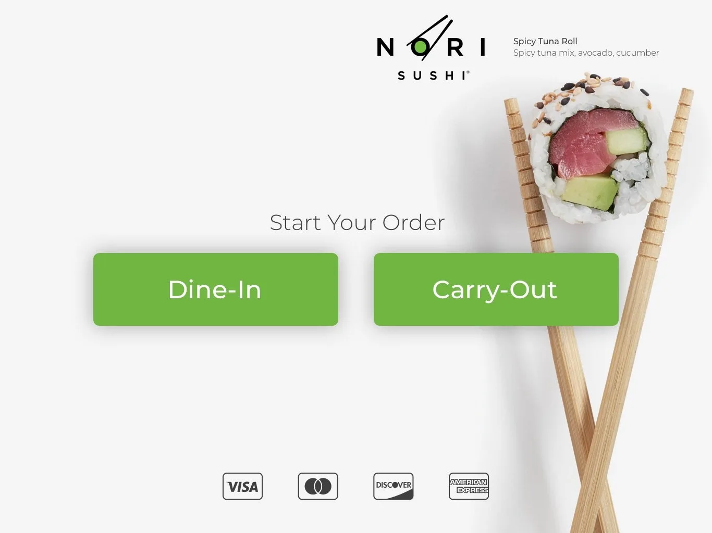
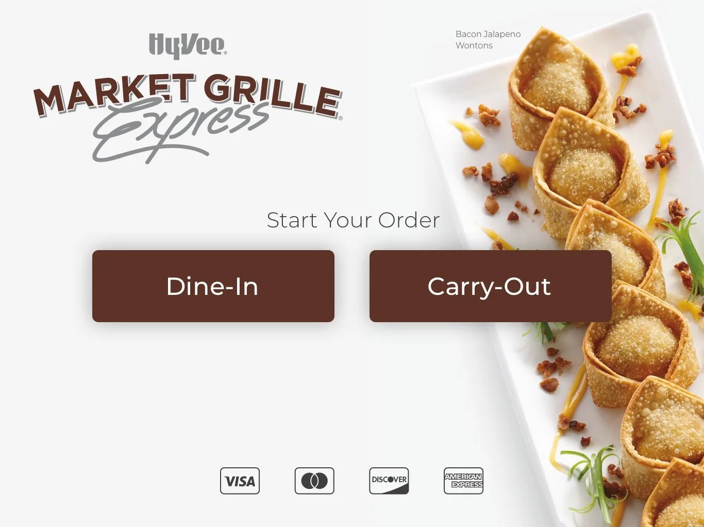
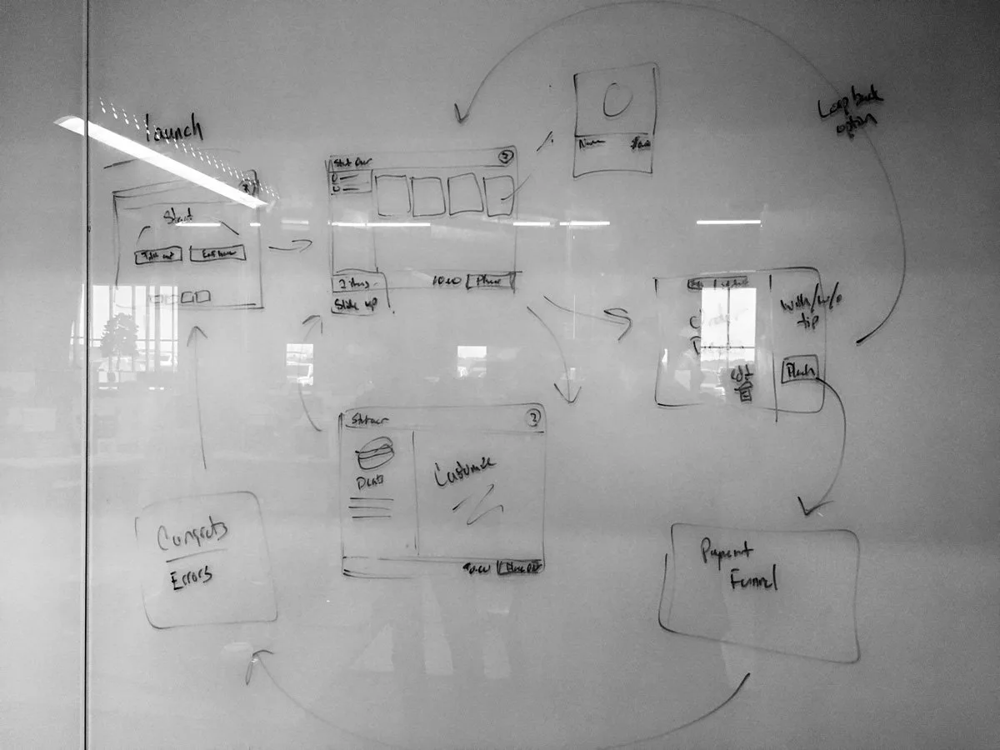
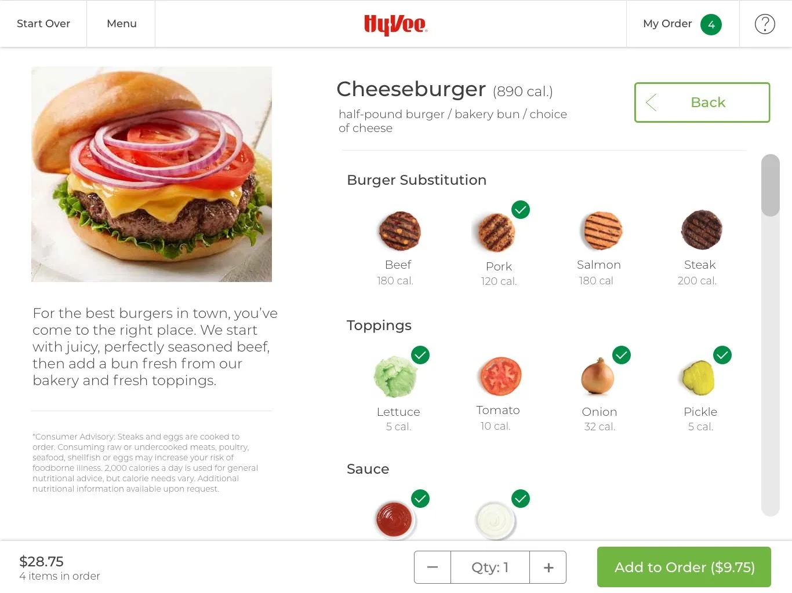
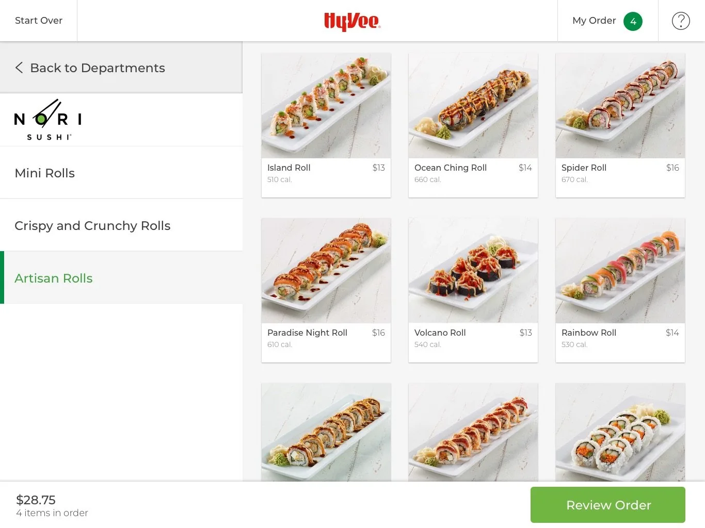
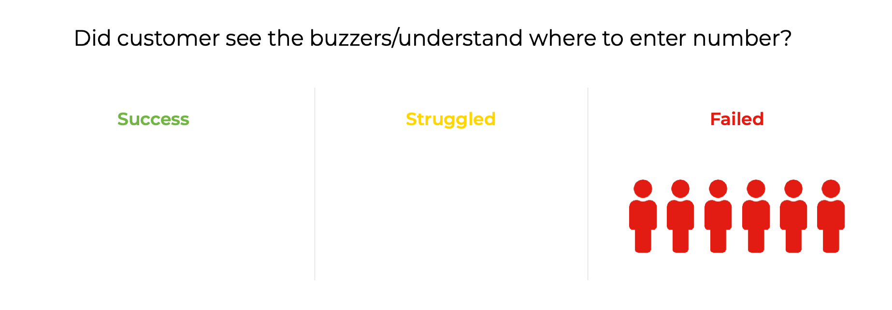
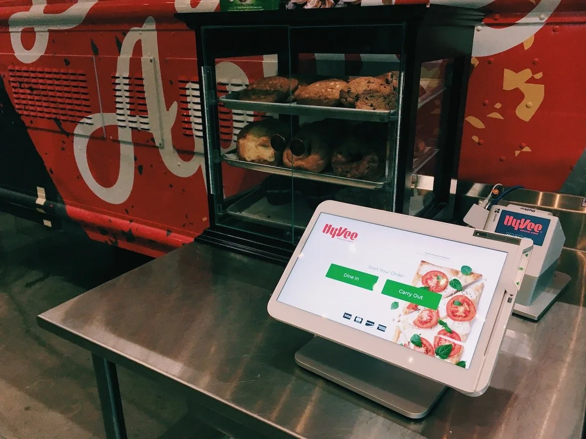
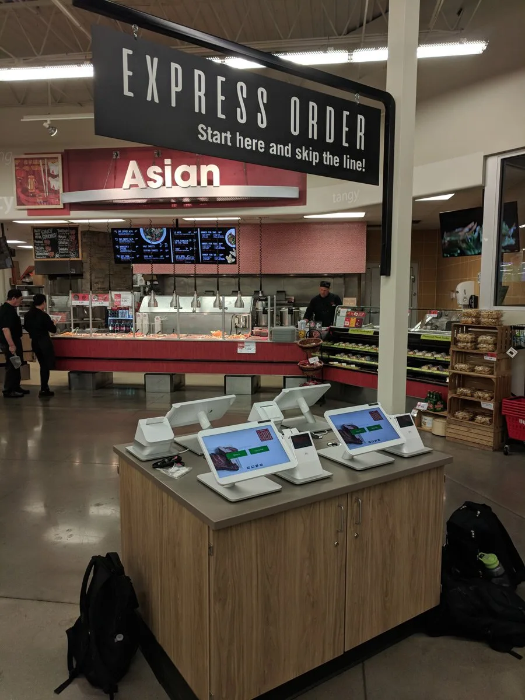

Hy-Vee sought to decrease customer wait times for in-store food service and provide a flexible self-service option for multiple store formats and brands. We were tasked with delivering a solution that allowed customers to order and check out in under 30 seconds while still upholding Hy-Vee’s hallmark customer service and brand.

::: grid-2

:::

## Role

Working with a fellow designer, we synthesized business and customer requirements and delivered workflows, wireframes and hi-fidelity visual designs on a very tight timeline. After launch, I conducted in-store user testing with customers and helped the dev team quickly iterate on and deploy design enhancements.

## Process

We worked to ensure all customer workflows were adaptable to relatively simple menu items (drinks) and complicated, multi-step orders (burritos). We took turns iterating on each other's ideas for the UI, and we held daily design reviews to refine and finalize visual designs.

## Solution

Usability testing showed that customers were able to order and check out well within our 30-second goal. The visual design of the kiosk showcases Hy-Vee’s culinary expertise while remaining scalable, accessible and intuitive.

::: grid-2

:::

## Challenges

We struggled to account for the physical constraints of the kiosks during the design phase, such as in-store layouts, signage and customers’ movements while shopping. For example, we designed the post-checkout flow under the assumption that cups and order buzzers would be available near the kiosks, which turned out not to be true in many stores.

## Outcomes

The kiosks were deployed in Hy-Vee stores across the midwest. They provided convenient ordering options for customers and enabled flexible staffing options for stores during off-peak times.

The in-store testing I conducted for this project (and resulting iterations) demonstrated to leadership the importance of requirement gathering, stakeholder interviews and challenging assumptions. We saw the intersection of digital and physical UX as it affected customers first hand.

::: grid-2

:::
