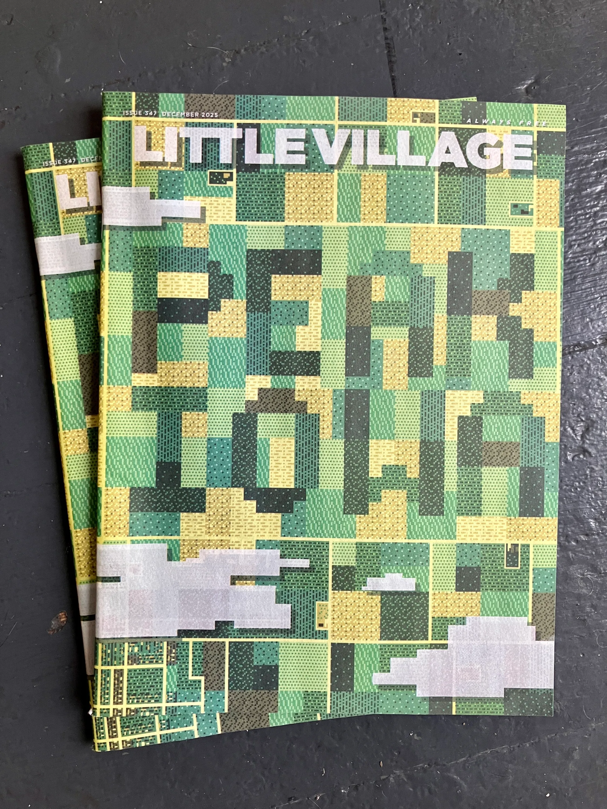
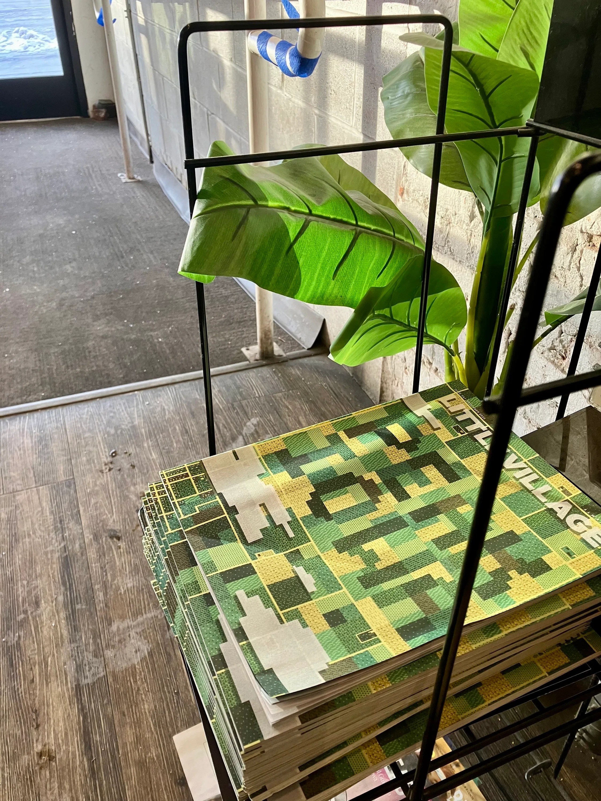

Cover illustration for the December 2025 ‘Peak Iowa’ issue of Little Village Magazine. Little Village (founded 2001 and headquartered in Iowa City) is Iowa’s most widely read news, arts and culture magazine.

Full digital issue available on [littlevillagemag.com](https://littlevillagemag.com/lv-december-2025/)

*Art Director: Jordan Sellergren  
LV Graphic Designer: Kellan Doolittle*

::: grid-2

:::
