This project investigates my personal associations of emotion with color, shape and texture. My interest in this investigation comes from my experiences in therapy, EMDR, meditation and yoga nidra. When I quietly observe my own emotions or internal states, they frequently show up as having some kind of form, usually with colors, size and shape and textures or consistency. Sometimes they have a certain type of motion or kinetic quality. I can usually get more clarity on this form by asking the feelings questions, like “How big are you?” or “What do you look like?”

My approach for this project involved 1) creating a set of symbols representing my interpretations of emotions and 2) using those symbols in an interactive, analog experience. The created solution functions as interactive wall art or a freestanding sculpture, which can be rearranged in response to your current feelings.

*Materials: laser-cut plywood, 3D printed PLA, acrylic paint*

::: grid-3
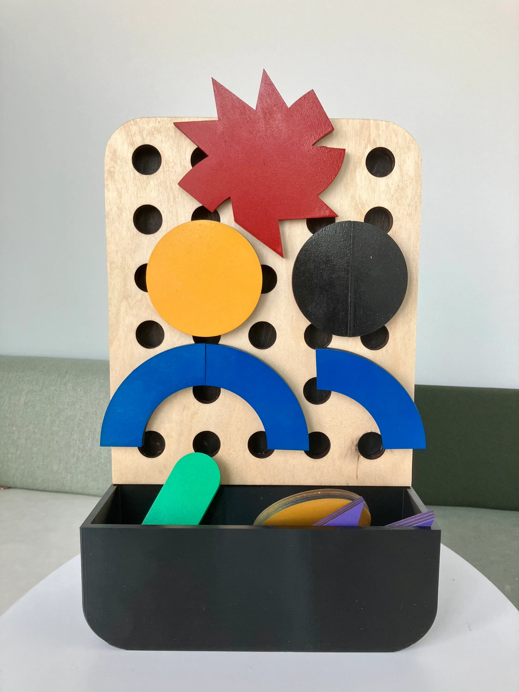
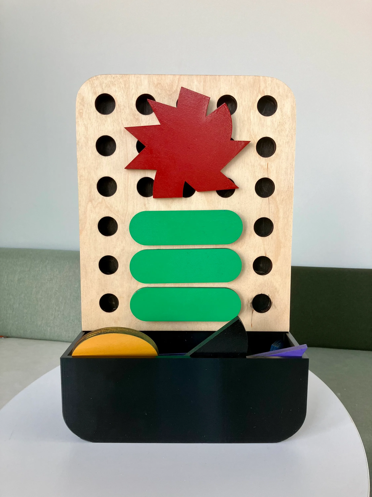
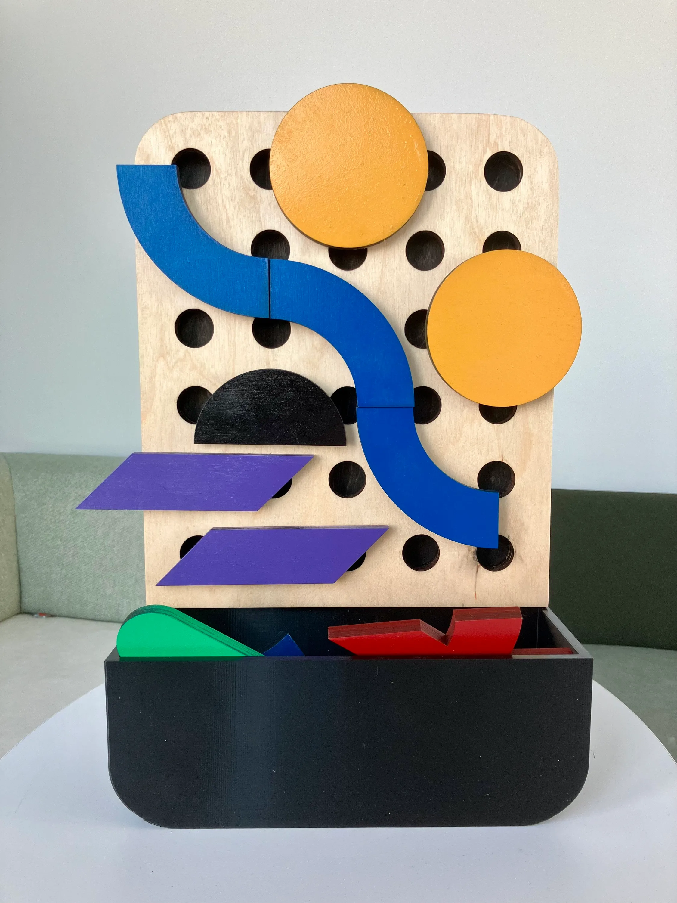
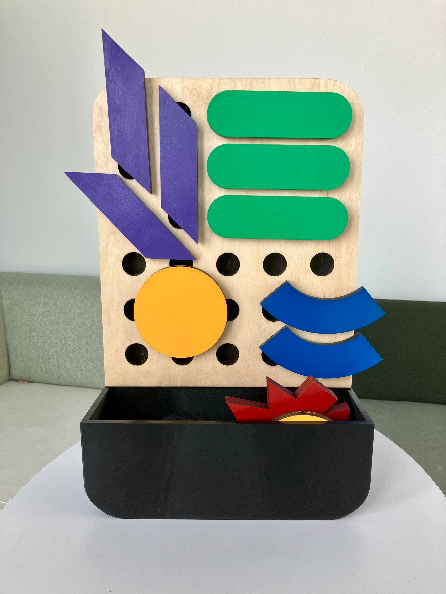
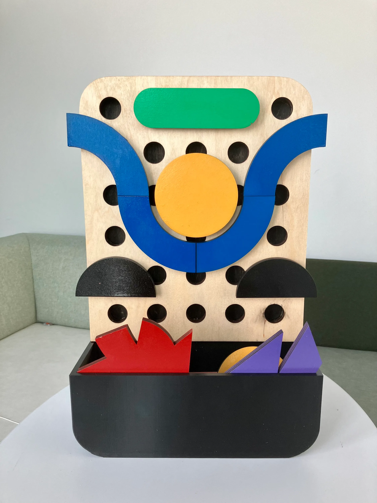
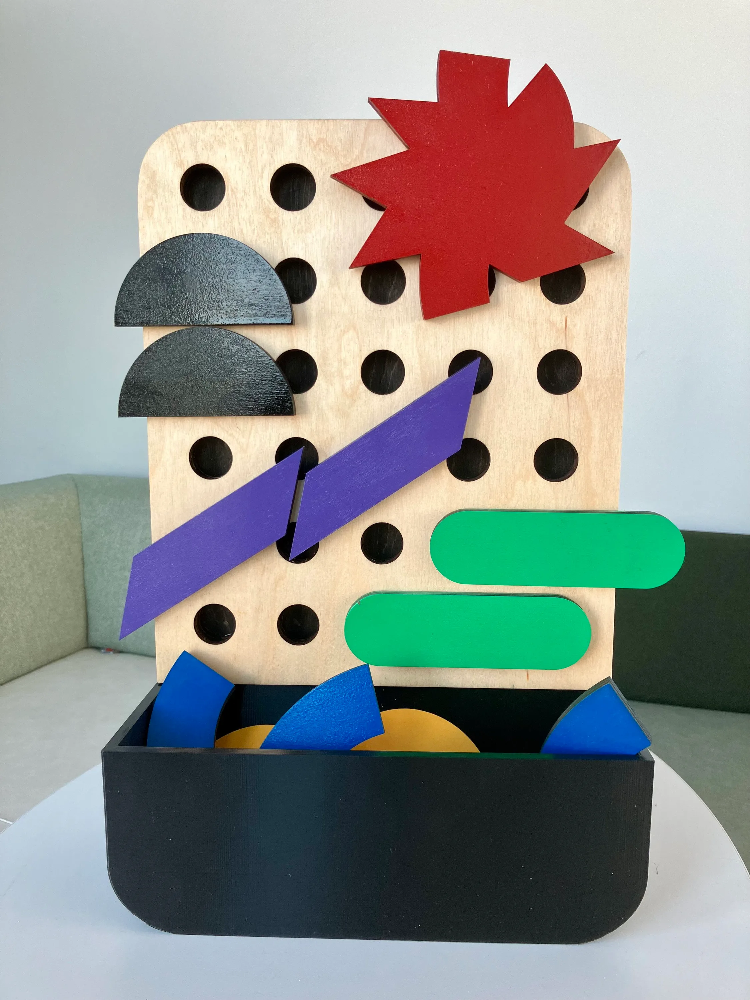
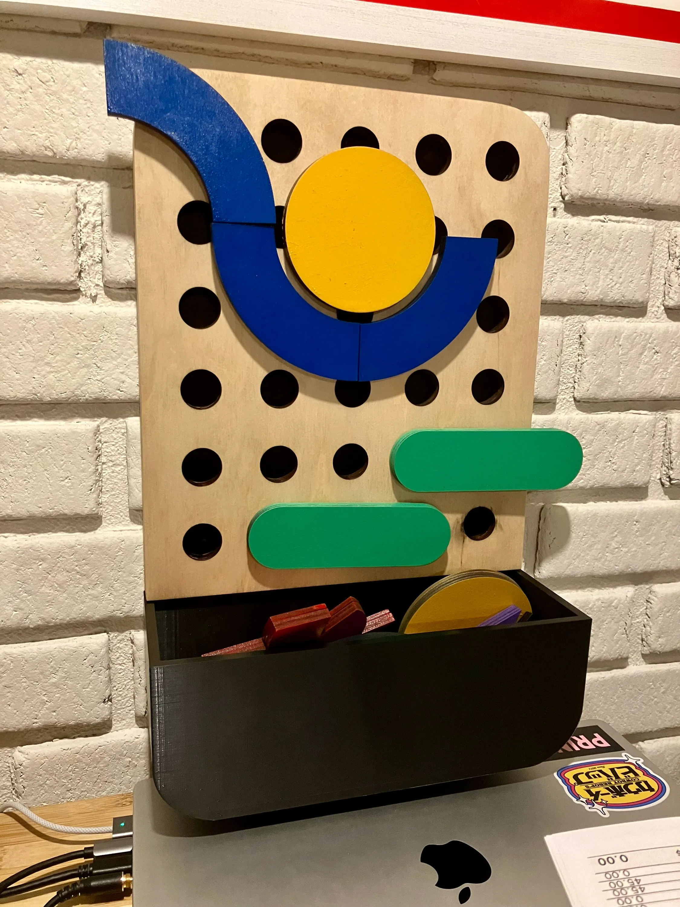
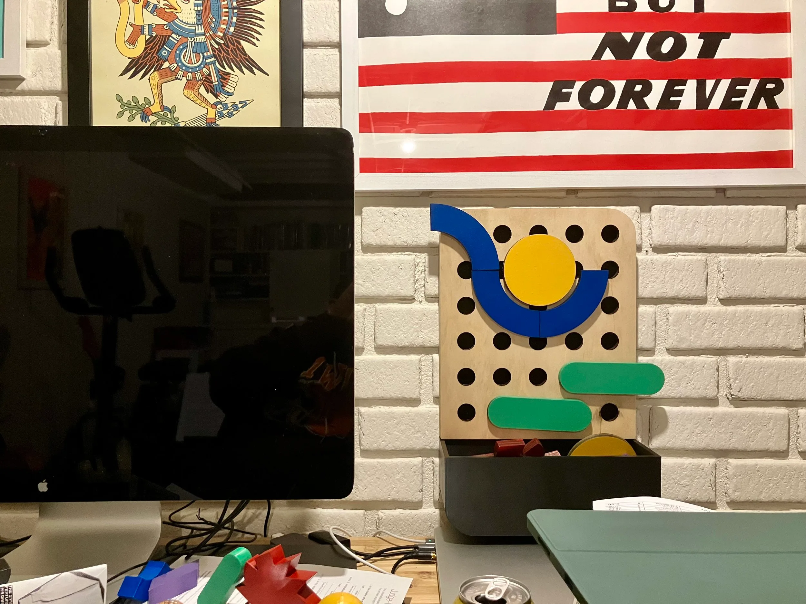
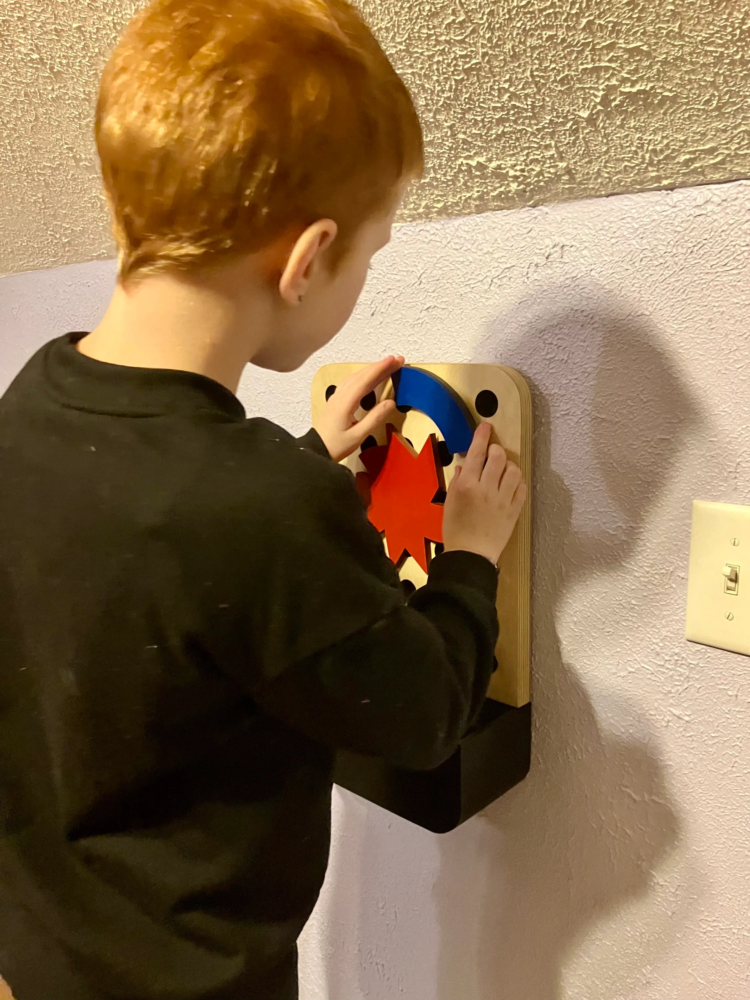
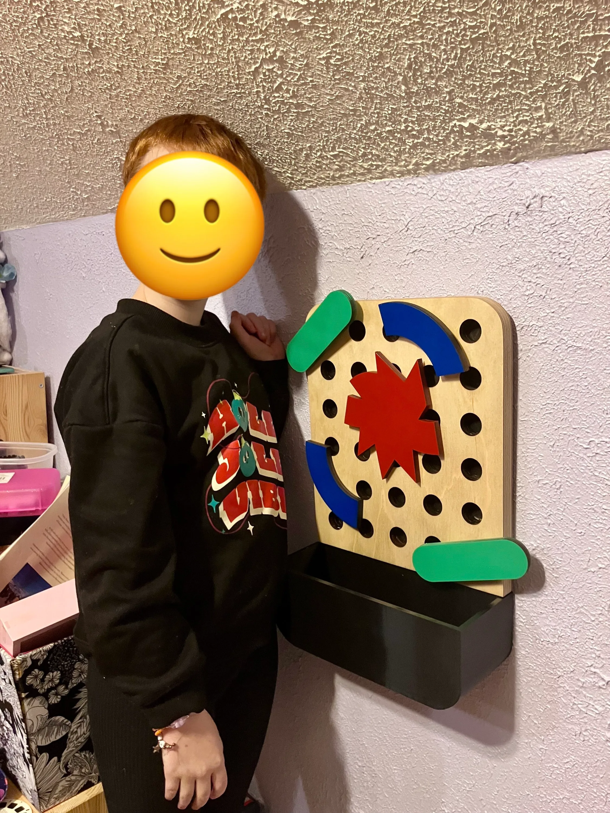
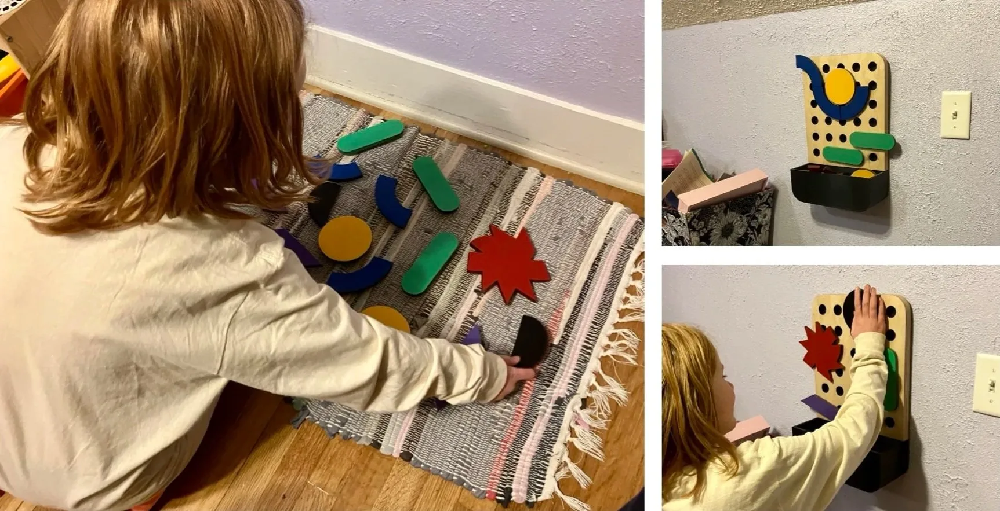
:::
