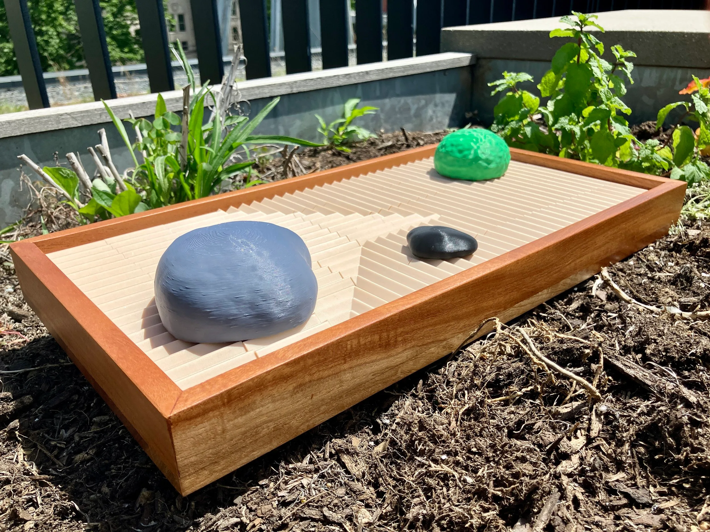
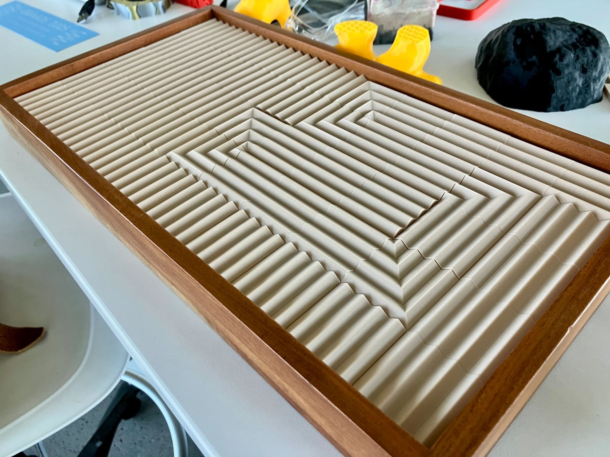
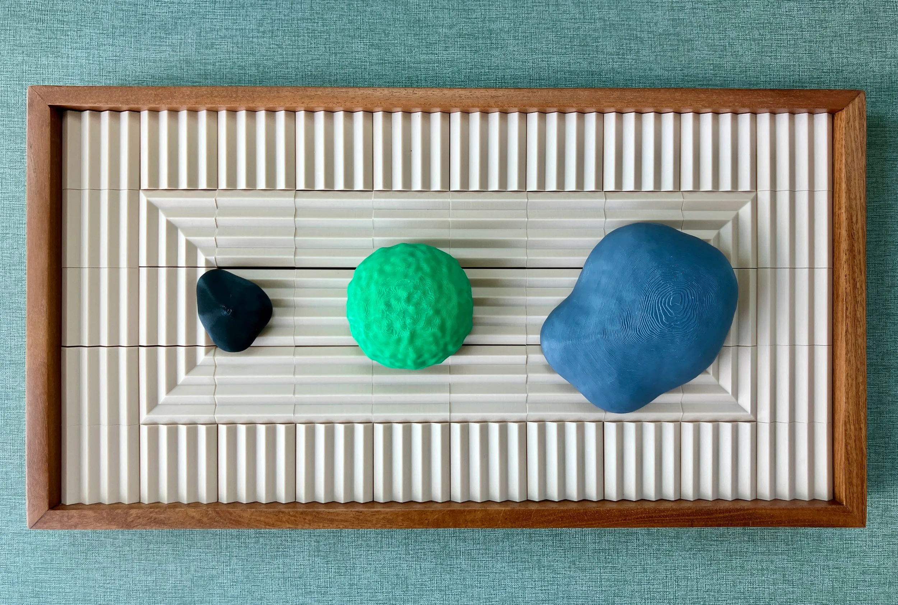
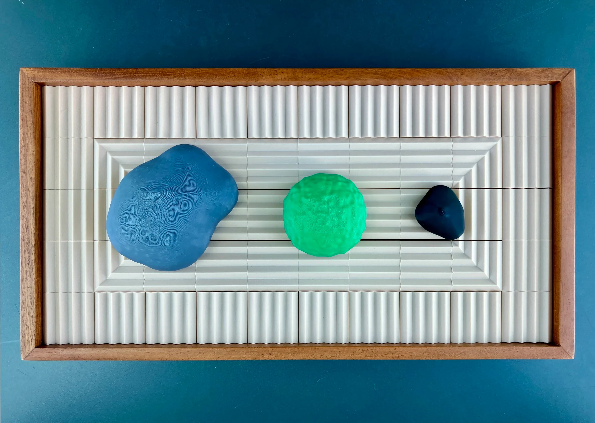
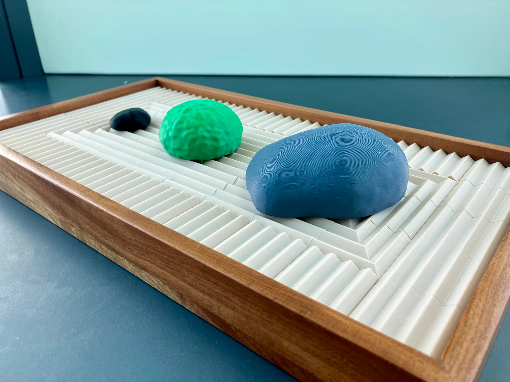

A less messy zen garden made of 3D printed blocks and organic shapes. Each block contains two patterns – straight lines and a corner – which allow for infinite combinations and patterns. I retrofitted the blocks to the wooden tray and learned a lot about 3D printer settings and tolerances.  
  
Modeled in Cinema 4D and printed in PLA on the Bambu X1C.

::: grid-3

:::
