Experiments using **p5.js**, **p5.riso** and the **Wikipedia API** to create procedurally generated zine layouts. Starting with a search term, the web app creates an 8-page spread using articles and photos from Wikipedia. Each spread is created in 2 colors, which are exported as black/transparent pngs for the Riso printers. Guides are not rendered using p5.riso and therefore don’t interfere with the exports.

[View project on Github](https://github.com/djmccurley/P5-Riso-Zine-Generator/blob/main/sketch.js)

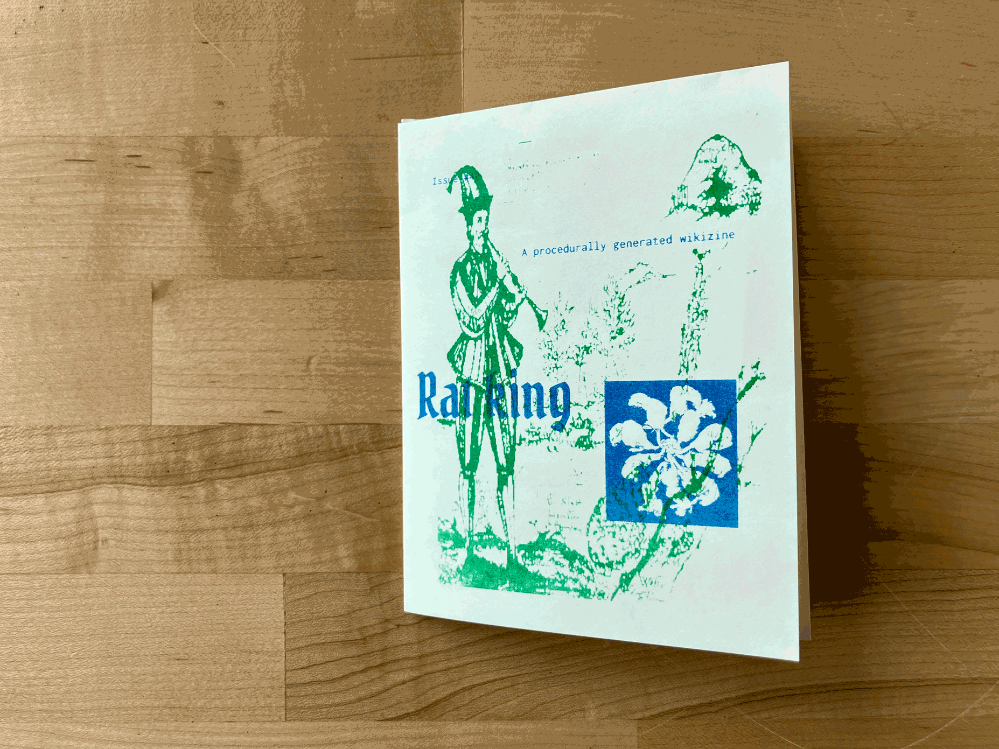

## demo video

<!-- TODO(video): upload imported-content/assets/procedural-riso-zines-video-1.mp4 to YouTube, then replace this comment with a YouTube block: a line ::: video https://youtu.be/VIDEO_ID "Title" followed by a closing ::: line (the title is required) -->

## content examples

::: grid-3
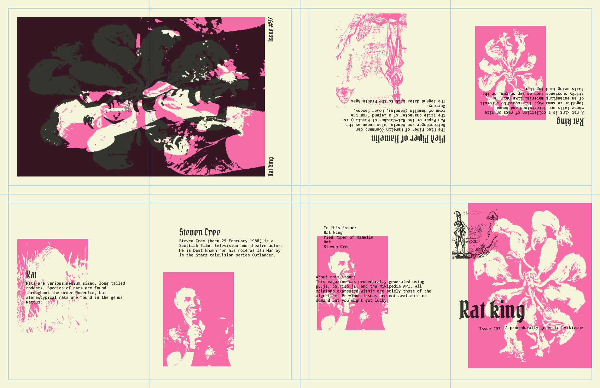
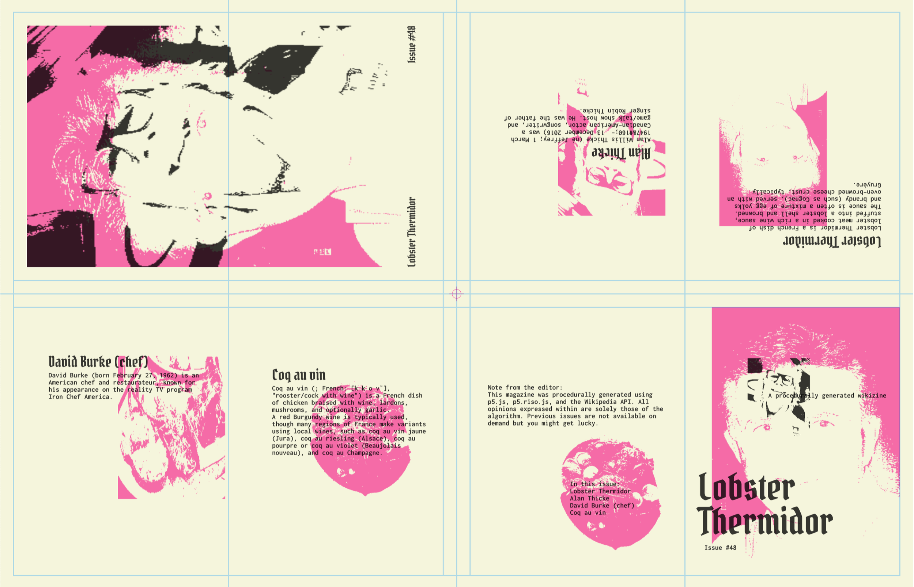
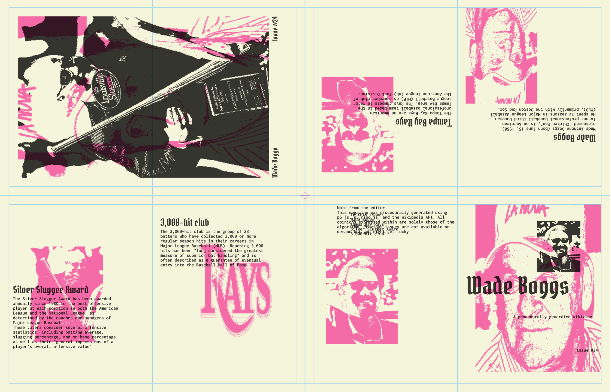
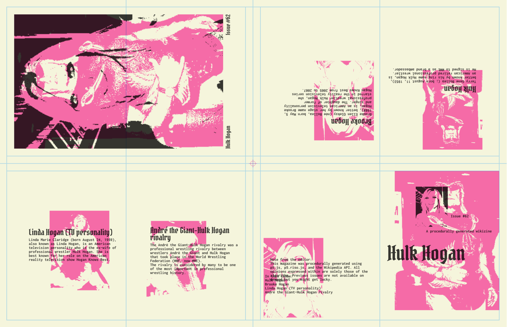
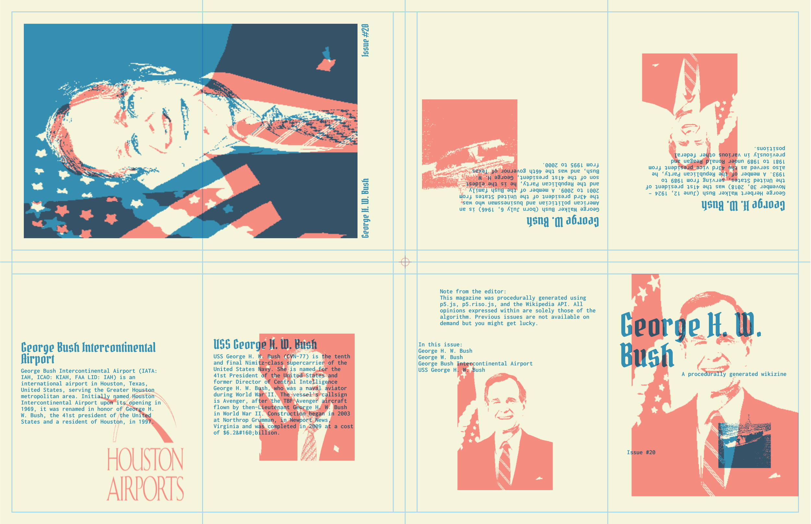
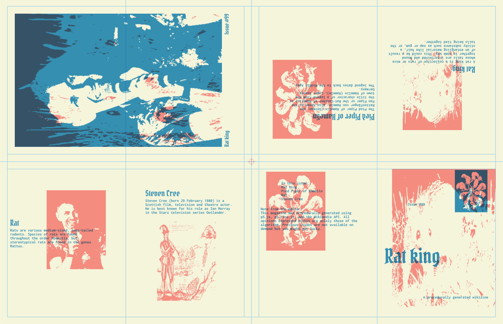
:::

## riso printing and assembly

::: grid-2
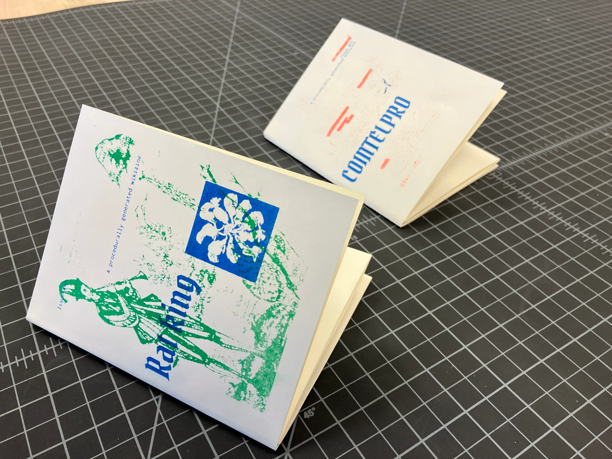
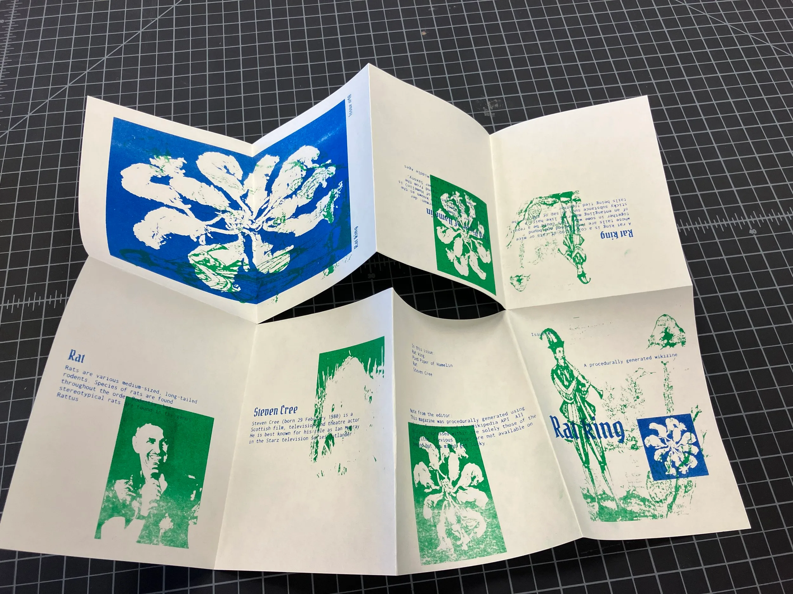
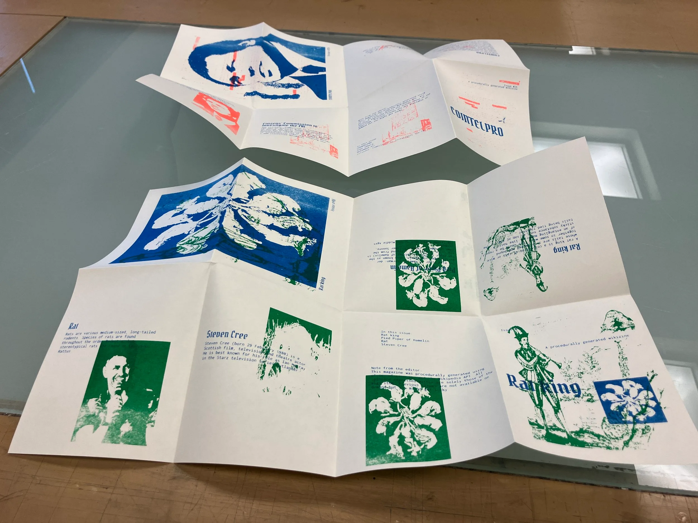
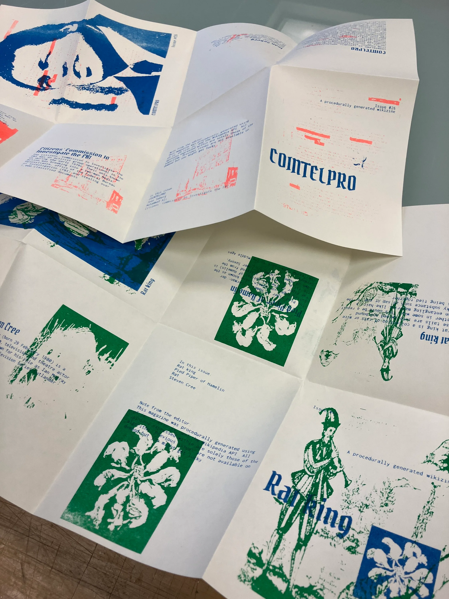
:::
