By remixing “universal” icons, familiar signage and poorly translated Japanese phrases, these signs offer equally digestible and dystopian messages. They disappear into innocuous settings while also presenting an unsettling and disorienting vision to those who look longer. This project speaks to how we desensitize ourselves to the horrors that continually surround us.

::: grid-3
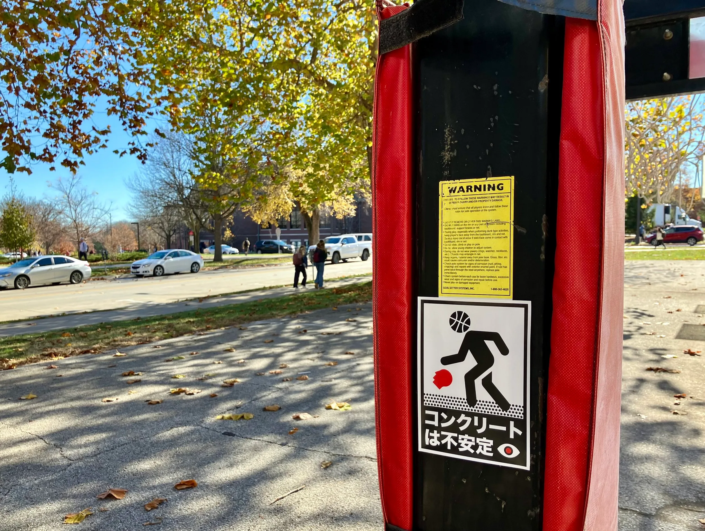
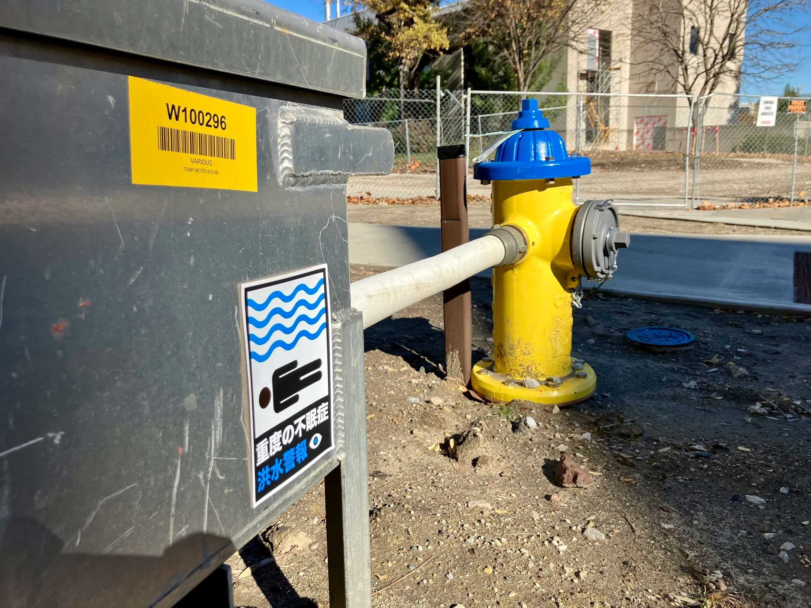
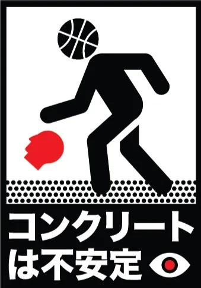
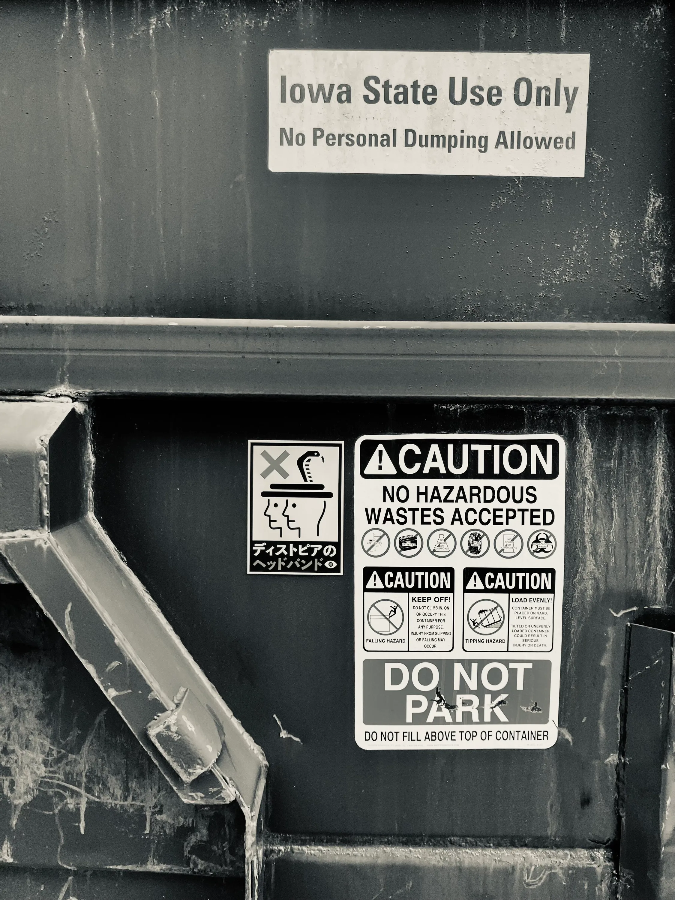
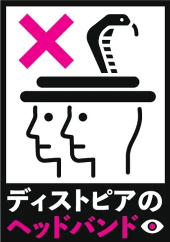
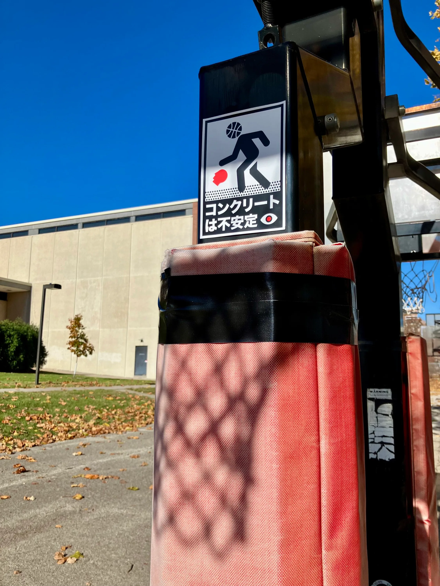
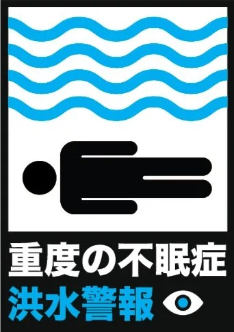
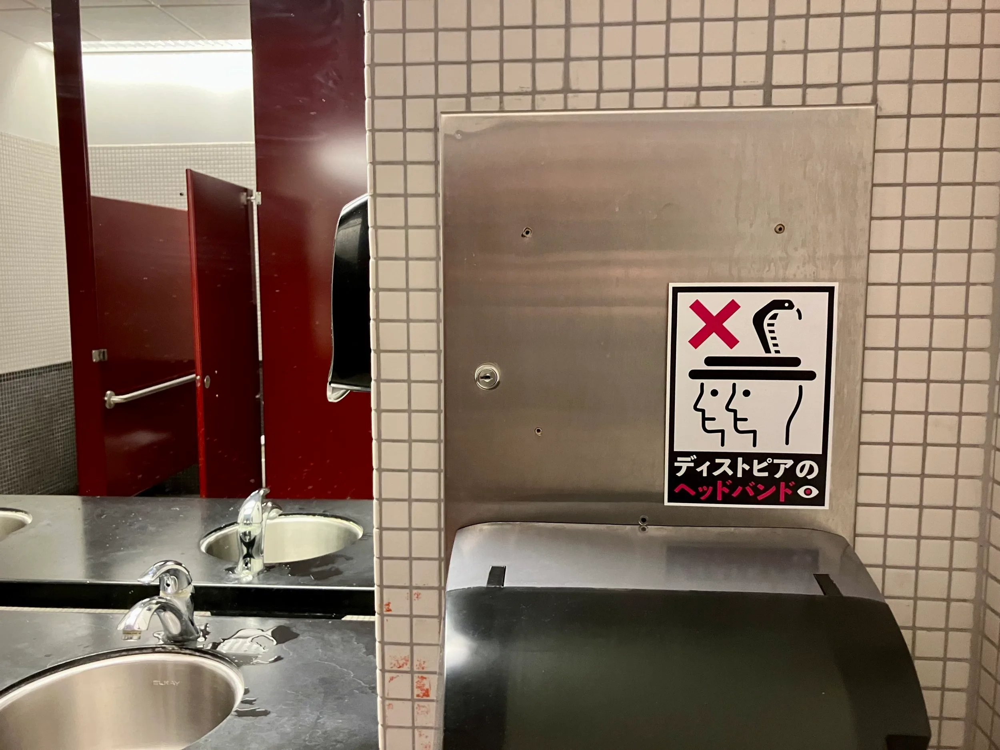
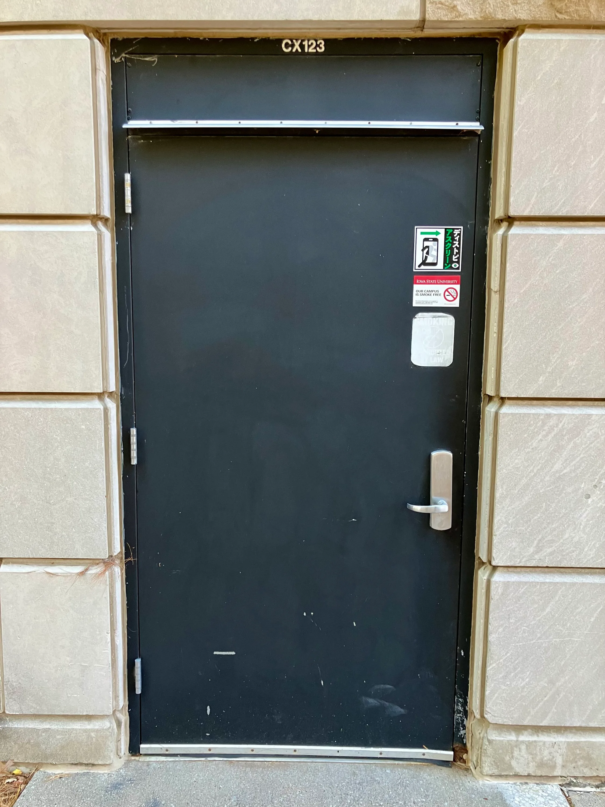
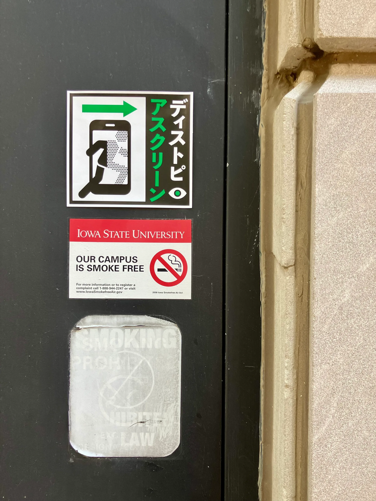
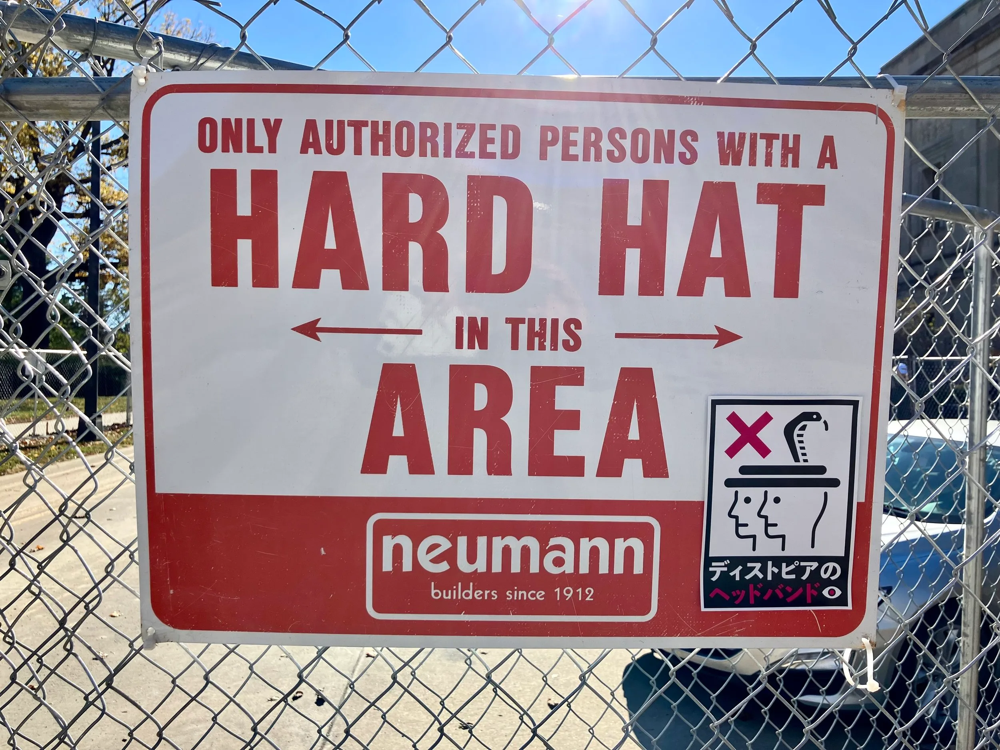
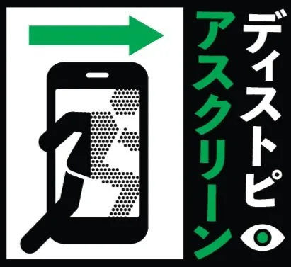
:::
