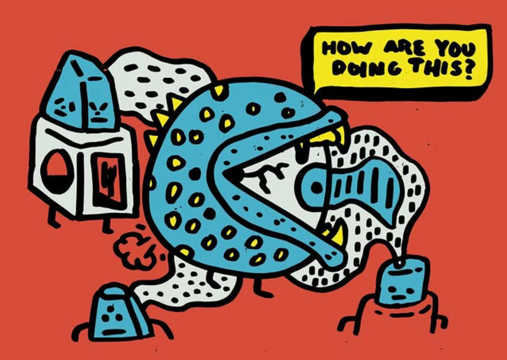

A small exploration game about tidepools and the creatures that live in them.

::: grid-2

:::

The look of the game leans on lo-fi screens and carved textures, so the interface feels like something you found rather than something you installed.

::: full

:::

::: video https://youtu.be/yLQFehW7FME "fjc demo week 10" 
:::

::: itch https://itch.io/embed-upload/5070357?color=333333 640x640 "Productivity Master" https://technolumina.itch.io/productivity-master
:::

::: video ../assets/tidepool-game-output.mp4 "PM trailer"
:::

::: video ../assets/tidepool-game-output.mp4 "Tidepool trailer" poster=../assets/poster.webp
:::

