wilbur is a fun, well-crafted member of your furniture family, ready to help out around the house! You can use wilbur as an end table, a book holder, a step stool, an extra seat or whatever else you can think of. Crafted out of natural hardwood, wilbur will bring sturdy, reliable fun to your home for years to come.

*wilbur is hand-built with White Ash, sustainably harvested from [Iowa State University’s TreeCycle program.](https://www.inside.iastate.edu/article/2017/10/19/treecycle)*

::: grid-3
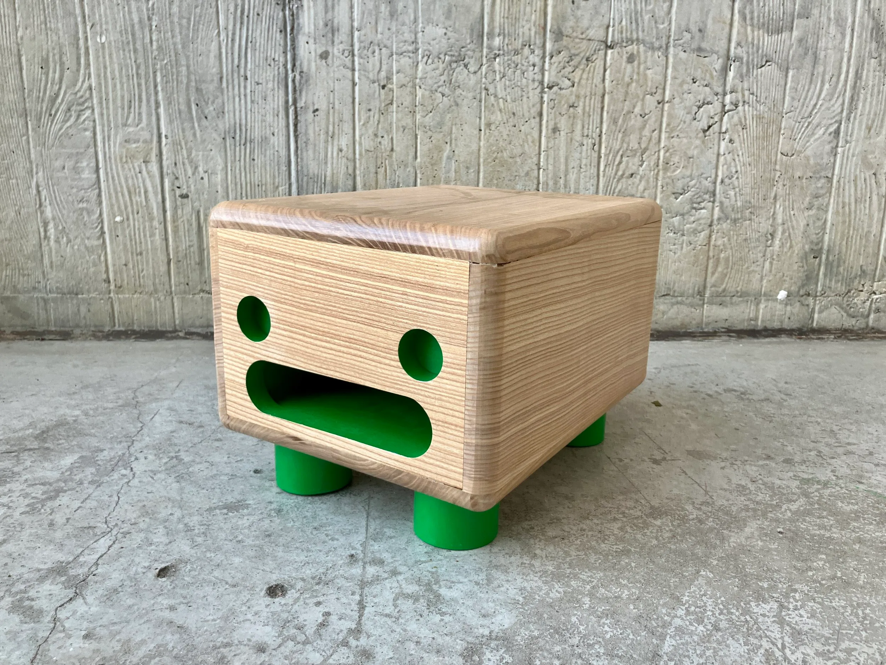
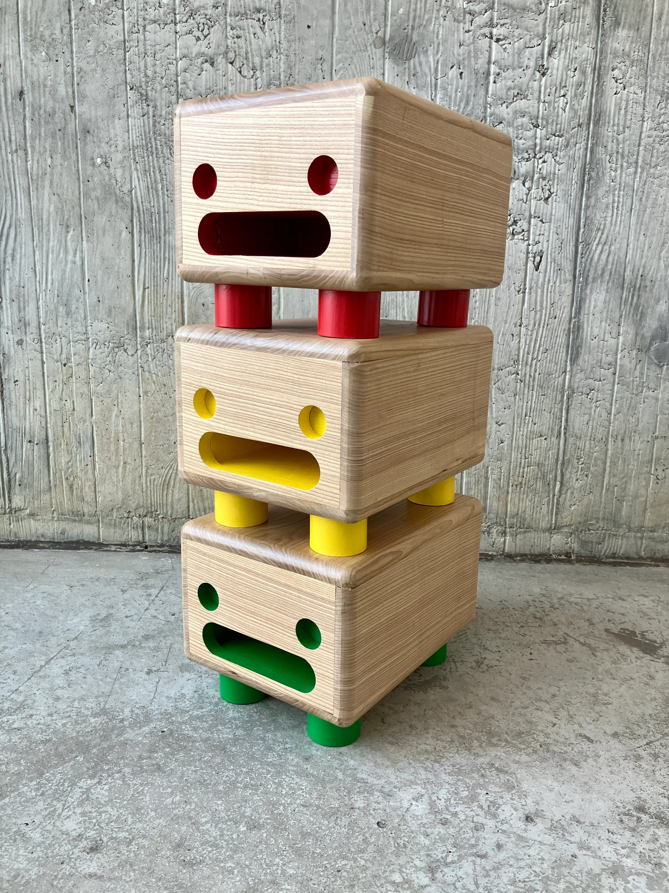
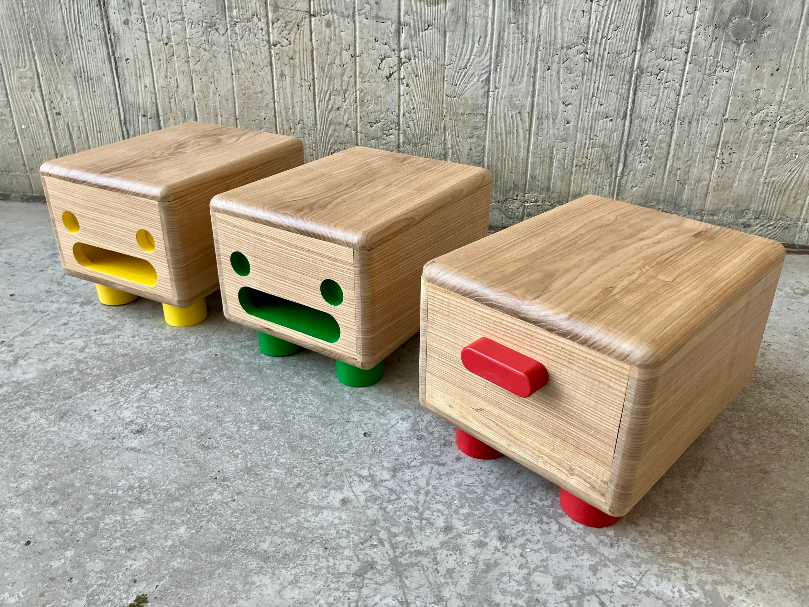
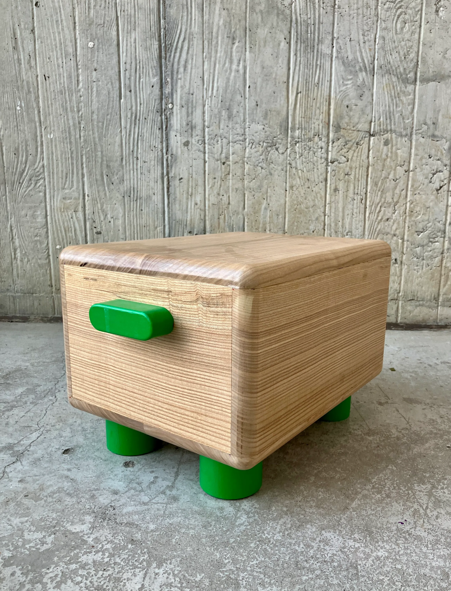
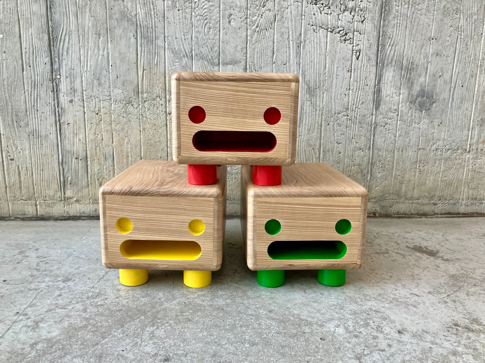
:::

## Concept sketches

::: grid-3
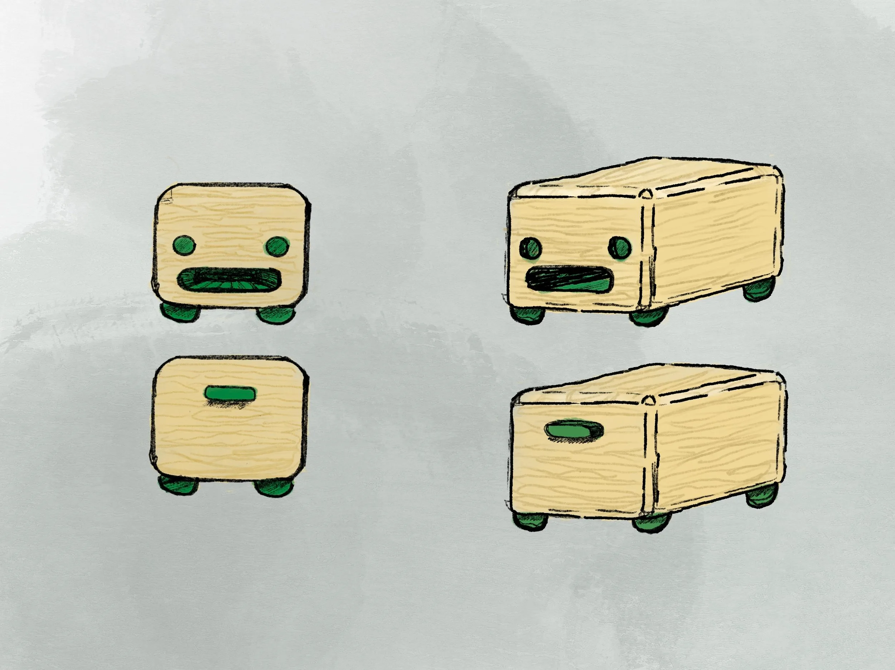
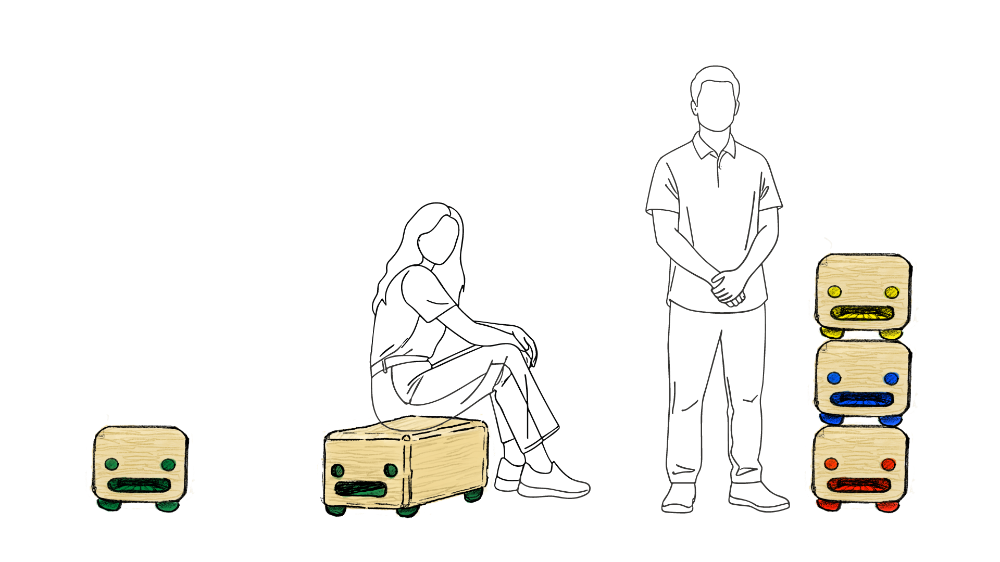
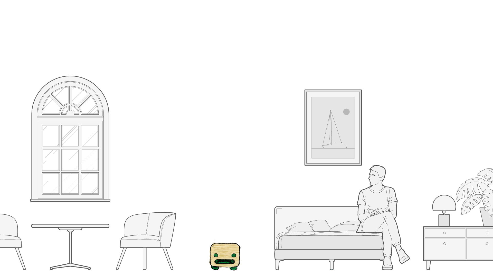
:::

## packaging concept

::: grid-3
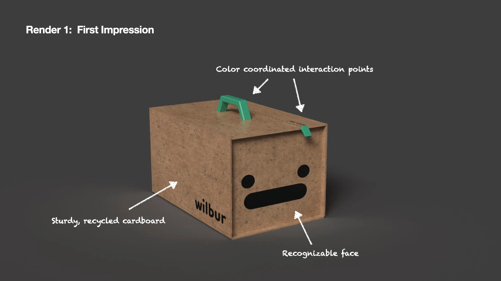
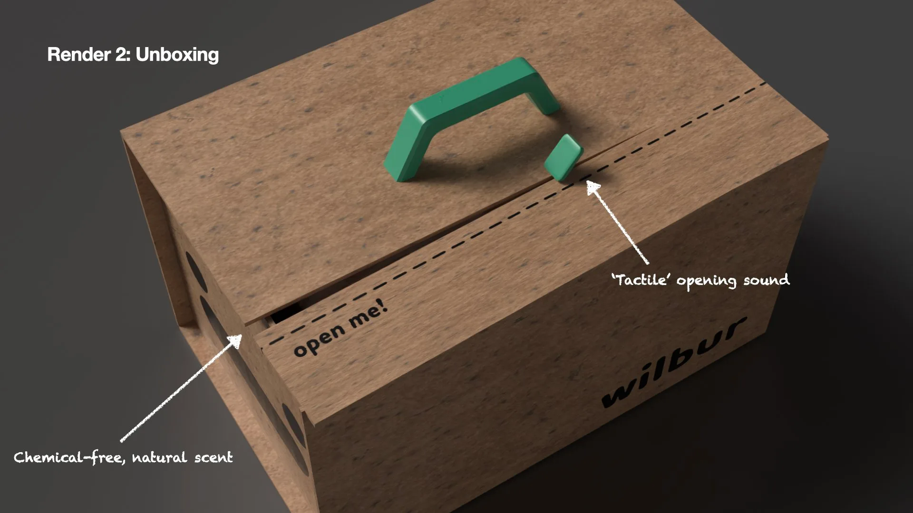
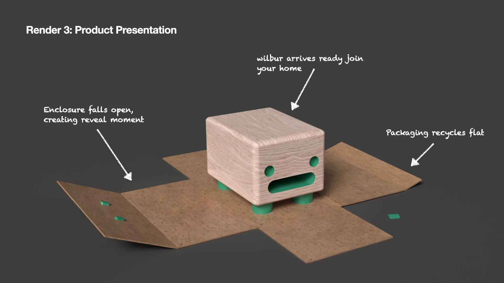
:::
